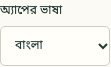
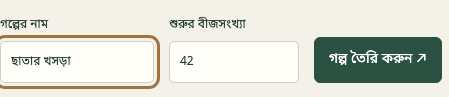
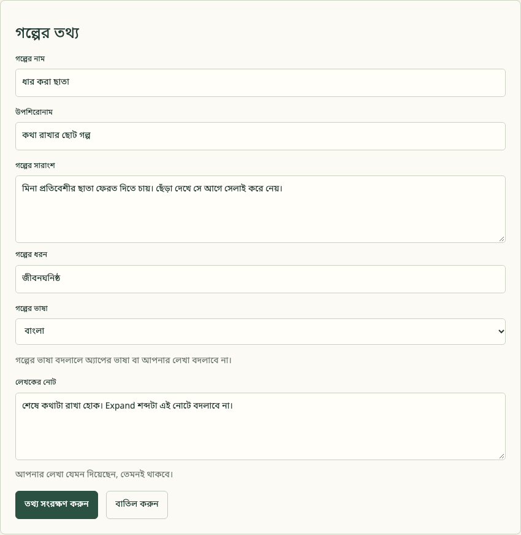
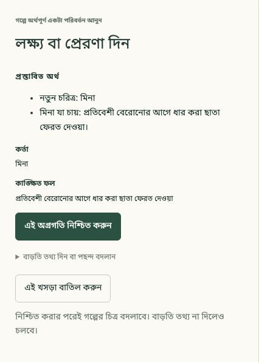
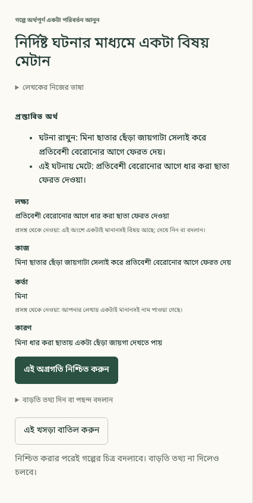
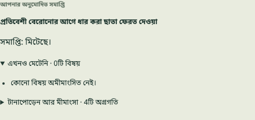

# {{ page.title }}

**ভাষা:** [English](../../topics/first-story.html) · বাংলা

**এখন আছে (Available) — ৮ নভেম্বর ২০২৬ তারিখে এখনও প্রকাশ না-করা পরীক্ষামূলক অ্যাপে পুরো পাঠ যাচাই করা হয়েছে।**

বর্তমান পরীক্ষামূলক সংস্করণটি ব্রাউজারে খোলা থাকতে হবে। পাঠ শেষে পাবেন ছোট একটা **গল্পের গাঁথুনি**, নিজে থেকে তৈরি গদ্যপাণ্ডুলিপি নয়।

## একটা কথা আর ছেঁড়া ছাতা

মিনা কথা দিয়েছে, প্রতিবেশী বেরোনোর আগেই ধার করা ছাতাটা ফেরত দেবে। পথে দেখে ছাতার একটা জায়গা ছেঁড়া। সে জায়গাটা সেলাই করে সময়মতো ছাতা ফিরিয়ে দেয়। কথাটা রাখা হয়।

মিনার একটা লক্ষ্য দেবেন, বাধাটা আনবেন, তার সঙ্গে মেরামতের ঘটনাটা যুক্ত করবেন, তারপর সমাপ্তি অনুমোদন করবেন। অনেক চরিত্র, বিস্তারিত জায়গা বা ঠিকঠাক তারিখ দেওয়ার দরকার নেই।

## ১. নতুন গল্প শুরু করুন

অ্যাপের ভাষা যদি এখনও English থাকে, তাহলে **Interface language** থেকে **বাংলা** বেছে নিন। আগে থেকেই বাংলা থাকলে কিছু বদলানোর দরকার নেই। বাংলায় এই পছন্দটির নাম **অ্যাপের ভাষা**।

*এই পছন্দ ব্রাউজারে মনে থাকবে। এতে আপনার লেখা বা গল্পের ভাষা বদলাবে না।*

**নতুন গল্প শুরু করুন** খুলুন। **গল্পের নাম** দিন **ছাতার খসড়া**। **শুরুর বীজসংখ্যা** যেমন আছে তেমন রেখে **গল্প তৈরি করুন ↗** বেছে নিন।

*এই পাঠে বীজসংখ্যা নিয়ে সৃজনশীল সিদ্ধান্ত লাগবে না।*

ফাঁকা কাজের জায়গা খুলবে। গল্পের নামের পাশে **গল্পের তথ্য** বেছে নিন। **গল্পের নাম** বদলে **ধার করা ছাতা** দিন। চাইলে উপশিরোনাম, সারাংশ, ধরন আর লেখকের নোটও দিতে পারেন; বাধ্যতামূলক নয়। নমুনার উপশিরোনাম **কথা রাখার ছোট গল্প**।

**গল্পের ভাষা** থেকে **বাংলা** বেছে নিয়ে **তথ্য সংরক্ষণ করুন** চাপুন। নতুন গল্পের ভাষা এখন শুরুতে **English** থাকে, অ্যাপের ভাষা বাংলা হলেও। গল্পের ভাষা আলাদাভাবে বদলাতে পারেন।

*নাম বদলালে নতুন গল্প তৈরি হয় না। তালিকা আর নাম আপডেট হয়। নিজের লেখা যেমন দেন তেমনই থাকে—নোটে English শব্দ থাকলেও।*

আবার **গল্পের তথ্য** খুলে বা পাতা নতুন করে খুলে দেখে নিতে পারেন। চাইলে কাজের মাঝেও অ্যাপের ভাষা English করে আবার বাংলায় ফিরুন; এমনকি এখনও সংরক্ষণ না-করা লেখাও থাকবে। নিচের নির্দেশের জন্য বাংলায় ফিরুন। তারপর দিকের বোতামগুলো থেকে **বিস্তার করুন** বেছে নিন।

## ২. মিনাকে কিছু চাইতে দিন

**লক্ষ্য বা প্রেরণা দিন** বেছে নিন।

**এটা কার লক্ষ্য?** প্রশ্নে **নতুন কাউকে বা কিছু যোগ করুন…** নিন। **তার নাম কী?** ঘরে লিখুন **মিনা**, তারপর **চালিয়ে যান**।

পরের প্রশ্ন **সে কী করতে চায়?** এখানে লিখুন:

> প্রতিবেশী বেরোনোর আগে ধার করা ছাতা ফেরত দেওয়া

আবার **চালিয়ে যান**। দরকারি প্রশ্ন বাকি থাকলে আগে সেগুলো আসে, তারপর প্রস্তাব দেখায়।

*নিশ্চিত করার আগে অর্থটা দেখে নিন।*

মিনা আর তার ইচ্ছা ঠিক আছে কি না দেখে **এই অগ্রগতি নিশ্চিত করুন** বেছে নিন। চিত্রে মিনা আর লক্ষ্য আসবে। বর্তমান অবস্থায় একটা না-মেটা লক্ষ্য দেখাবে।

## ৩. একটা বাধা আসুক

**বিস্তার করুন** রেখেই **আরেকটা নির্দিষ্ট ঘটনা** নিন। **কী ঘটেছিল?** ঘরে লিখুন:

> মিনা ধার করা ছাতায় একটা ছেঁড়া জায়গা দেখতে পায়

**চালিয়ে যান**, ঘটনা পড়ুন, তারপর **এই অগ্রগতি নিশ্চিত করুন**। চিত্রে আবিষ্কারের ঘটনা আসবে। লক্ষ্য এখনও মেটেনি: ছেঁড়া দেখলেই তো কথা রাখা হয়ে যায় না।

এটাই এই সংস্করণের সাধারণ ঘটনা যোগ করার বোতাম। এই ছোট পাঠে দ্বিতীয় চরিত্র বা আলাদা বস্তু হিসেবে ছাতা তৈরি করা লাগবে না।

## ৪. এবার মিনা কথা রাখুক

**মীমাংসা করুন**, তারপর **নির্দিষ্ট ঘটনার মাধ্যমে একটা বিষয় মেটান** নিন।

এখানে একটা লক্ষ্যই বাকি, তাই প্রস্তাবে সেটা বেছে নেওয়া যেতে পারে। **কী ঘটলে এটা মেটে?** ঘরে লিখুন:

> মিনা ছাতার ছেঁড়া জায়গাটা সেলাই করে প্রতিবেশী বেরোনোর আগে ফেরত দেয়

**চালিয়ে যান**। লক্ষ্য হিসেবে মিনার আগের ইচ্ছাটাই আছে কি না দেখুন।

**বাড়তি তথ্য দিন বা পছন্দ বদলান** খুলে **চাইলে বলুন: কোন ঘটনা থেকে এই মীমাংসা আসে?** নিন। **মিনা ধার করা ছাতায় একটা ছেঁড়া জায়গা দেখতে পায়** বেছে **চালিয়ে যান** চাপুন। প্রস্তাব পড়ার সময় বাড়তি তথ্যের তালিকা গুটিয়ে নিতে পারেন।

*মেরামতে কথা রাখা হয়; যে আবিষ্কার থেকে কাজটা এল, তার সঙ্গেও যোগ থাকে। এই যোগ ঘটনার সম্পর্ক ধরে, নির্দিষ্ট ঘড়ির সময় দেয় না।*

**এই অগ্রগতি নিশ্চিত করুন** নিন। না-মেটা বিষয়ের সংখ্যা এখন শূন্য হবে। অ্যাপ আপনার ঠিক করা ফল রেকর্ড করেছে; গদ্যের মান বিচার করেনি বা ঘড়ি মিলিয়ে শেষ সময় যাচাই করেনি।

## ৫. এবার গল্প শেষ হয়েছে ঠিক করুন

**শেষ করুন** নিন। সমাপ্তির জন্য কয়েকটি পছন্দ আসবে। **সব বিষয় মিটিয়ে এই সমাপ্তি অনুমোদন করুন** বেছে নিন।

*দেখে নিন: **আপনার অনুমোদিত সমাপ্তি**, **সমাপ্তি: মিটেছে।**, আর **এখনও মেটেনি · 0টি বিষয়**। অনুমোদনের পর আবার অনুমোদন চাইবে না।*

হয়ে গেল: মিনার একটা ইচ্ছা ছিল, বাধা এল, তার জন্য কাজ করল, আর আপনার অনুমোদিত সমাপ্তিতে পৌঁছাল। গাঁথুনি এই কম্পিউটারে সংরক্ষিত থাকে। **আপনার গল্পগুলো** থেকে আবার খুলতে পারবেন।

## কোথাও ভুল হলে

**প্রস্তাব ভুল বলছে:** নিশ্চিত করার আগে **বাড়তি তথ্য দিন বা পছন্দ বদলান** খুলে দরকারি **বদলান:** প্রশ্নটি নিন, উত্তর দিন, আবার **চালিয়ে যান**। সঠিক প্রস্তাব পড়েই নিশ্চিত করুন।

**তাড়াতাড়ি সমাপ্তি অনুমোদন করেছেন:** **↶ শেষ সিদ্ধান্ত ফিরিয়ে নিন** বেছে নিন। সবশেষ অনুমোদিত সমাপ্তি আবার খোলে, ইতিহাস থাকে। দেখে নিয়ে আবার অনুমোদন করতে পারেন। এটা সর্বশেষ সিদ্ধান্ত ফেরায়; যেকোনো পুরোনো অংশ সম্পাদনা করে না। এই দুই উদ্ধারপথ বর্তমান অ্যাপে ইংরেজি আর বাংলা—দুই ভাষাতেই চালিয়ে যাচাই করা হয়েছে।

## একটু অন্যভাবে দেখুন

চাইলে নতুন সংস্করণে মিনা **বেরোনোর আগেই** ছেঁড়া দেখুক। ঘটনাটা বদলালে একই মেরামত কি এখনও স্বাভাবিকভাবে আসে? এটা সৃজনশীল চেষ্টা করার আমন্ত্রণ, আরেকটা যাচাই করা ধাপে-ধাপে পাঠ নয়। কোন বদলে গল্পের অর্থ বদলায়, আপনি ঠিক করবেন।

এবার একাধিক লক্ষ্য আর ইচ্ছে করে খোলা রাখা একটা প্রশ্ন নিয়ে কাজ করতে চাইলে [বড় গল্পের পদ্ধতি](richer-story.md) আর [মায়ার রহস্যগল্পের পাঠ](impossible-letter.md)-এ যেতে পারেন।
