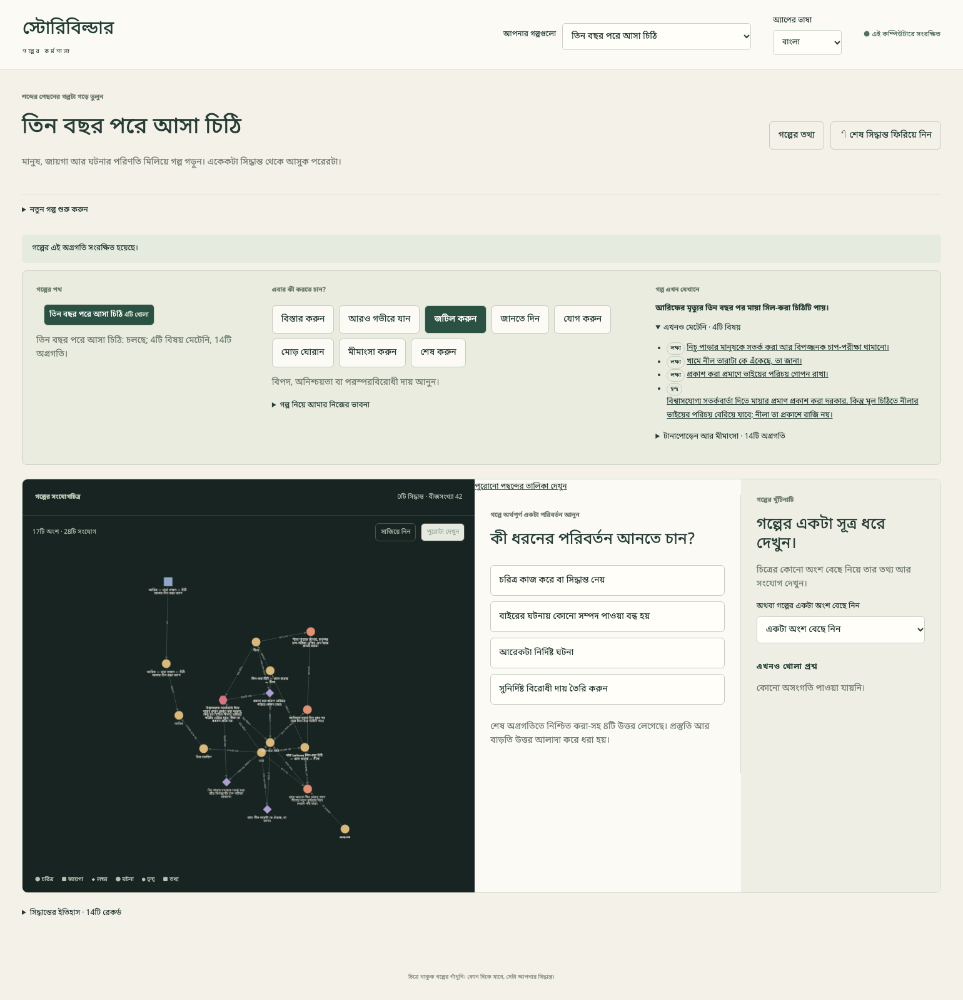
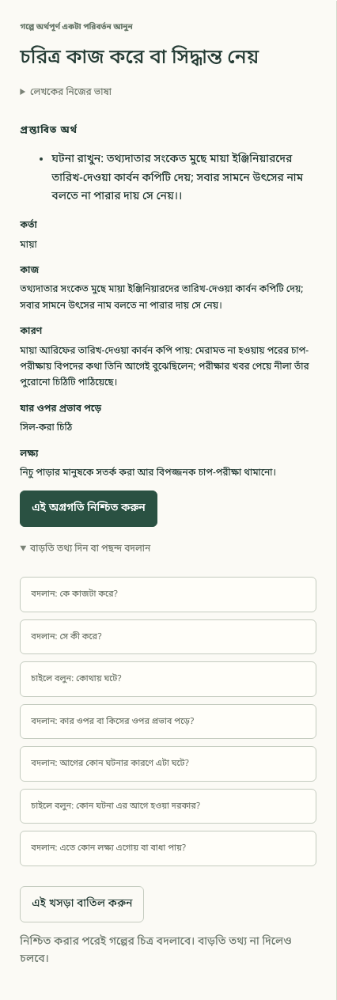
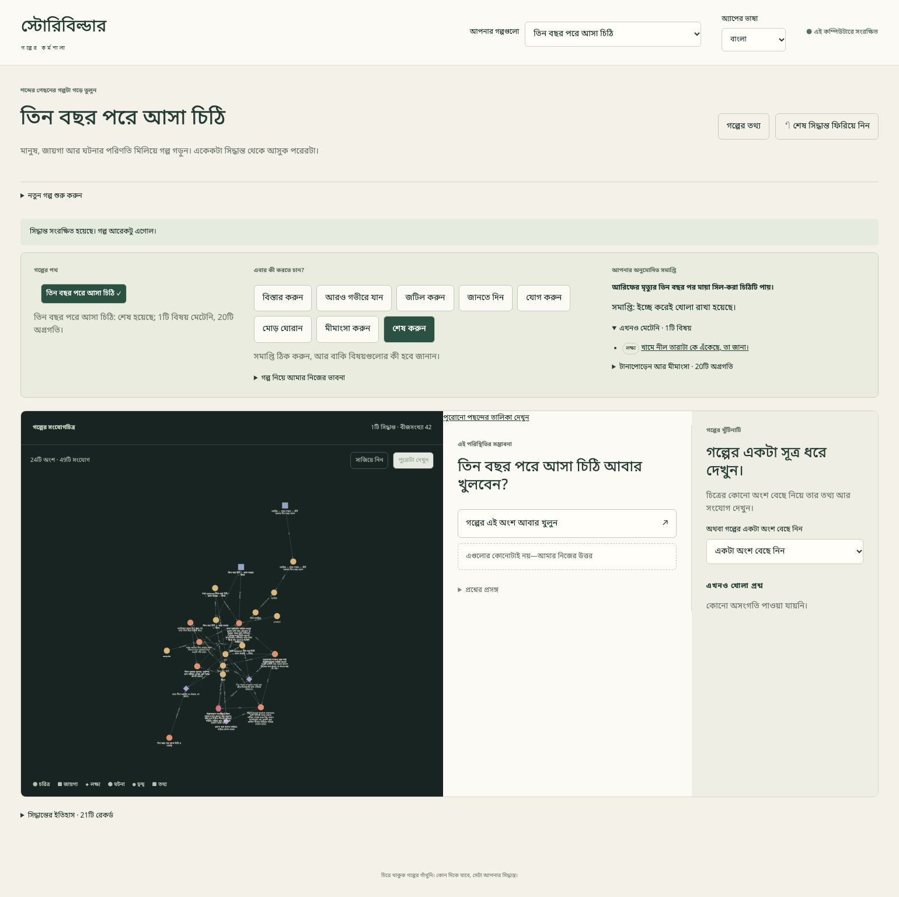
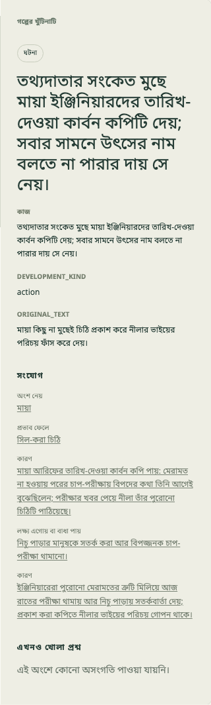

# {{ page.title }}

**ভাষা:** [English](../../topics/impossible-letter.html) · বাংলা

**এখন আছে (Available) — ৮ নভেম্বর ২০২৬ তারিখে এখনও প্রকাশ না-করা পরীক্ষামূলক অ্যাপে পুরো পাঠ যাচাই করা হয়েছে।**

## তিন বছর পরে আসা চিঠি

আরিফের মৃত্যুর তিন বছর পর তাঁর স্ত্রী মায়া সিল-করা একটা চিঠি পায়। হাতের লেখা আরিফের মতো। বন্যার ফটকের পরের চাপ-পরীক্ষায় নিচু পাড়া ডুবে যাবে—চিঠিতে এই সতর্কবার্তা। কুরিয়ার নীলা যতটা বলছে, তার চেয়ে বেশি জানে। তার ভাই গোপনে রক্ষণাবেক্ষণের নথি দিয়েছিল; মূল চিঠি প্রকাশ করলে তার পরিচয় বেরিয়ে যেতে পারে।

এটা লেখকের কাজ শেখার পাঠ, তাই রহস্যের উত্তর আগেই বলছি। আমরা স্বাভাবিক একটা ব্যাখ্যা বেছে নেব; অ্যাপকে রহস্য সমাধান করতে বলব না। নতুন পরীক্ষার খবর পেয়ে নীলা আসল পুরোনো সতর্কবার্তাটি পাঠিয়েছে। তথ্যদাতার পরিচয় না খুলেও কাজে লাগে, এমন প্রমাণ মায়াকে খুঁজতে হবে। খামের অচেনা নীল তারাটা খোলা প্রশ্ন হয়ে থাকবে।

আগে [ছোট্ট গল্পের পাঠ](first-story.md) শেষ করুন, তারপর [বড় গল্পে কাজের পদ্ধতি](richer-story.md) পড়ুন। এখানে তৈরি হবে সম্পর্ক ধরে রাখা গল্পের গাঁথুনি; গদ্য, দৃশ্যের ক্রম বা পাঠক কখন কী জানবেন, তার তালিকা নয়। নিচের সব কাজ বর্তমান বোতাম দিয়েই করা যায়; নতুন করে স্তর ভাগ বা দল সাজানোর সুবিধা লাগবে না।

## প্রথম অগ্রগতির আগে

**নতুন গল্প শুরু করুন** থেকে নাম দিন **তিন বছর পরে আসা চিঠি**। অ্যাপ English থাকলে **Interface language** থেকে **বাংলা** নিন; বাংলায় এই পছন্দটির নাম **অ্যাপের ভাষা**। **গল্পের তথ্য** খুলে **গল্পের ভাষা → বাংলা** নিন। নতুন গল্পের ভাষা এখন শুরুতে English থাকে, অ্যাপ বাংলা হলেও। **লেখকের নোট**-এ লিখুন: “এটি গল্পের গাঁথুনি, গদ্য নয়। নীল তারার রহস্য ইচ্ছে করে খোলা থাকবে।” তথ্য সংরক্ষণ করুন।

নম্বরের ক্রমে এগোন। প্রতিটি অগ্রগতিতে কোন দিক আর কোন বোতাম নিতে হবে, বলা আছে। [বড় গল্পে কাজের পদ্ধতি](richer-story.md) মেনে নিচে দেওয়া সব ঘর পূরণ করুন; কোনো কোনোটি আগেই বেছে দেওয়া থাকতে পারে। “৫ নম্বর ধাপ” মানে সেই ধাপের তৈরি বিষয়টি তালিকা থেকে নেবেন; কথাটা লিখবেন না, আবার নতুন করেও তৈরি করবেন না। কাছাকাছি নাম থাকলে তালিকায় চরিত্র, বক্তব্য, তথ্য বা বিশ্বাসের ধরন দেখে নিন। পরে একই বক্তব্য ব্যবহার করার সময় তার বিষয়, সম্পর্কের কথা আর অন্য ব্যক্তিকে একই রাখুন।

## ১. অসম্ভব আগমনটা তৈরি করুন

আরিফের মৃত্যু গল্পের সত্যি হিসেবে রাখছি। তাঁর মতো হাতের লেখা পাওয়া তদন্তের সূত্র; মৃত মানুষ গতকাল লিখেছেন, তার প্রমাণ নয়। মায়ার লক্ষ্য থাকায় সতর্কবার্তাটা তার নিজের শোকের বাইরেও মানুষের জীবনে জরুরি হয়ে ওঠে।

### ১. মায়াকে আনুন

**বিস্তার করুন → মানুষ, জায়গা, বস্তু বা সম্পদ যোগ করুন** নিন।

- **কাকে বা কী যোগ করছেন?** — চরিত্র
- **কী দিয়ে তাকে চেনা যাবে? একটা নাম দিন।** — মায়া

প্রস্তাবের অর্থ আর বেছে দেওয়া বিষয়গুলো দেখে **এই অগ্রগতি নিশ্চিত করুন** নিন।

### ২. আরিফকে মনে রাখুন

**বিস্তার করুন → মানুষ, জায়গা, বস্তু বা সম্পদ যোগ করুন** নিন।

- **কাকে বা কী যোগ করছেন?** — চরিত্র
- **কী দিয়ে তাকে চেনা যাবে? একটা নাম দিন।** — আরিফ
- **কোন প্রসঙ্গটা মনে রাখা দরকার?** — মায়ার স্বামী; চিঠি আসার তিন বছর আগে তিনি মারা গেছেন।

প্রস্তাবের অর্থ আর বেছে দেওয়া বিষয়গুলো দেখে **এই অগ্রগতি নিশ্চিত করুন** নিন।

### ৩. সতর্কবার্তাটা নির্দিষ্ট রাখুন

**বিস্তার করুন → মানুষ, জায়গা, বস্তু বা সম্পদ যোগ করুন** নিন।

- **কাকে বা কী যোগ করছেন?** — বস্তু
- **কী দিয়ে তাকে চেনা যাবে? একটা নাম দিন।** — সিল-করা চিঠি
- **কোন প্রসঙ্গটা মনে রাখা দরকার?** — আরিফের মতো হাতের লেখায় সতর্কবার্তা: বন্যার ফটকের পরের চাপ-পরীক্ষায় নিচু পাড়া ডুবে যাবে।

প্রস্তাবের অর্থ আর বেছে দেওয়া বিষয়গুলো দেখে **এই অগ্রগতি নিশ্চিত করুন** নিন।

### ৪. মৃত্যুটা সত্যি হিসেবে রাখুন

**জানতে দিন → নির্দিষ্ট তথ্য বা বিশ্বাস যোগ করুন** নিন।

- **বক্তব্যটা কাকে বা কী নিয়ে?** — আরিফ (২ নম্বর ধাপ)
- **তার সম্পর্কে কী বলা হচ্ছে?** — মারা গেছেন
- **মান বা সম্পর্কিত বিষয় কী?** — চিঠি আসার তিন বছর আগে
- **কে এটাকে জানা কথা হিসেবে ধরতে পারে?** — গল্পের বাস্তব তথ্য

প্রস্তাবের অর্থ আর বেছে দেওয়া বিষয়গুলো দেখে **এই অগ্রগতি নিশ্চিত করুন** নিন।

### ৫. চিঠি এসে পৌঁছাক

**বিস্তার করুন → আরেকটা নির্দিষ্ট ঘটনা** নিন।

- **কী ঘটেছিল?** — আরিফের মৃত্যুর তিন বছর পর মায়া সিল-করা চিঠিটি পায়।
- **কে বা কী এটা শুরু করেছিল?** — মায়া (১ নম্বর ধাপ)
- **কার ওপর বা কিসের ওপর প্রভাব পড়ে?** — সিল-করা চিঠি (৩ নম্বর ধাপ)

প্রস্তাবের অর্থ আর বেছে দেওয়া বিষয়গুলো দেখে **এই অগ্রগতি নিশ্চিত করুন** নিন।

### ৬. শোকের বাইরেও মায়ার একটা লক্ষ্য থাকুক

**আরও গভীরে যান → লক্ষ্য বা প্রেরণা দিন** নিন।

- **এটা কার লক্ষ্য?** — মায়া (১ নম্বর ধাপ)
- **সে কী করতে চায়?** — নিচু পাড়ার মানুষকে সতর্ক করা আর বিপজ্জনক চাপ-পরীক্ষা থামানো।
- **লক্ষ্যটা কাকে বা কী নিয়ে?** — সিল-করা চিঠি (৩ নম্বর ধাপ)

প্রস্তাবের অর্থ আর বেছে দেওয়া বিষয়গুলো দেখে **এই অগ্রগতি নিশ্চিত করুন** নিন।

**দেখে নিন:** চিত্রে সাতটি বিষয় আর একটি না-মেটা লক্ষ্য।

## ২. সন্দেহের একটা মূল্য থাকুক

কুরিয়ার সিল নীলার দিকে ইঙ্গিত করে, কিন্তু চিঠি জাল হওয়ার প্রমাণ নয়। মায়াকে এখানে ইচ্ছে করেই ভুল ধারণা দিচ্ছি। ভাইকে আড়াল করতে চাওয়া নীলার আলাদা ইচ্ছা; তাতে সে খলনায়ক হয়ে যায় না। নীল তারার প্রশ্নটা লক্ষ্য হিসেবে রাখব, যাতে সমাপ্তিতে সেটাকে খোলা রাখার সিদ্ধান্ত দেখা যায়।

### ৭. ভুল পথে নিতে পারে এমন সিল পাওয়া যাক

**জানতে দিন → আরেকটা নির্দিষ্ট ঘটনা** নিন।

- **কী ঘটেছিল?** — খামে অচেনা নীল তারার পাশে নীলার নতুন কুরিয়ার সিল দেখতে পায় মায়া।
- **কে বা কী এটা শুরু করেছিল?** — মায়া (১ নম্বর ধাপ)
- **কার ওপর বা কিসের ওপর প্রভাব পড়ে?** — সিল-করা চিঠি (৩ নম্বর ধাপ)
- **আগের কোন ঘটনার কারণে এটা ঘটে?** — আরিফের মৃত্যুর তিন বছর পর মায়া সিল-করা চিঠিটি পায়। (৫ নম্বর ধাপ)

প্রস্তাবের অর্থ আর বেছে দেওয়া বিষয়গুলো দেখে **এই অগ্রগতি নিশ্চিত করুন** নিন।

### ৮. যে প্রশ্ন খোলা রাখব, তাকে নাম দিন

**আরও গভীরে যান → লক্ষ্য বা প্রেরণা দিন** নিন।

- **এটা কার লক্ষ্য?** — মায়া (১ নম্বর ধাপ)
- **সে কী করতে চায়?** — খামে নীল তারাটা কে এঁকেছে, তা জানা।
- **লক্ষ্যটা কাকে বা কী নিয়ে?** — সিল-করা চিঠি (৩ নম্বর ধাপ)

প্রস্তাবের অর্থ আর বেছে দেওয়া বিষয়গুলো দেখে **এই অগ্রগতি নিশ্চিত করুন** নিন।

### ৯. নীলাকে আনুন

**বিস্তার করুন → মানুষ, জায়গা, বস্তু বা সম্পদ যোগ করুন** নিন।

- **কাকে বা কী যোগ করছেন?** — চরিত্র
- **কী দিয়ে তাকে চেনা যাবে? একটা নাম দিন।** — নীলা
- **কোন প্রসঙ্গটা মনে রাখা দরকার?** — একসময় আরিফের সঙ্গে কাজ করত এই কুরিয়ার; তার ভাই গোপনে রক্ষণাবেক্ষণের নথি দিয়েছিল।

প্রস্তাবের অর্থ আর বেছে দেওয়া বিষয়গুলো দেখে **এই অগ্রগতি নিশ্চিত করুন** নিন।

### ১০. মায়া আর আরিফের সম্পর্ক রাখুন

**যোগ করুন → সম্পর্ক তৈরি করুন** নিন।

- **সম্পর্কটা কার দিক থেকে?** — মায়া (১ নম্বর ধাপ)
- **তাদের সম্পর্ক কেমন?** — বিয়ে হয়েছিল
- **সম্পর্কটা কার সঙ্গে?** — আরিফ (২ নম্বর ধাপ)

প্রস্তাবের অর্থ আর বেছে দেওয়া বিষয়গুলো দেখে **এই অগ্রগতি নিশ্চিত করুন** নিন।

### ১১. নীলার নিজের লক্ষ্যও থাকুক

**আরও গভীরে যান → লক্ষ্য বা প্রেরণা দিন** নিন।

- **এটা কার লক্ষ্য?** — নীলা (৯ নম্বর ধাপ)
- **সে কী করতে চায়?** — প্রকাশ করা প্রমাণে ভাইয়ের পরিচয় গোপন রাখা।
- **লক্ষ্যটা কাকে বা কী নিয়ে?** — সিল-করা চিঠি (৩ নম্বর ধাপ)

প্রস্তাবের অর্থ আর বেছে দেওয়া বিষয়গুলো দেখে **এই অগ্রগতি নিশ্চিত করুন** নিন।

### ১২. মায়া চিঠি জাল হওয়ার সন্দেহ করুক

**জানতে দিন → নির্দিষ্ট তথ্য বা বিশ্বাস যোগ করুন** নিন।

- **বক্তব্যটা কাকে বা কী নিয়ে?** — সিল-করা চিঠি (৩ নম্বর ধাপ)
- **তার সম্পর্কে কী বলা হচ্ছে?** — জাল করেছে
- **মান বা সম্পর্কিত বিষয় কী?** — আগে থাকা বিষয়টি নিন: নীলা (৯ নম্বর ধাপ)
- **কে এটাকে জানা কথা হিসেবে ধরতে পারে?** — চরিত্রের বিশ্বাস
- **কে এটা বিশ্বাস করে?** — মায়া (১ নম্বর ধাপ)
- **কোন ঘটনায় এটা প্রতিষ্ঠিত হয় বা জানা যায়?** — খামে অচেনা নীল তারার পাশে নীলার নতুন কুরিয়ার সিল দেখতে পায় মায়া। (৭ নম্বর ধাপ)

প্রস্তাবের অর্থ আর বেছে দেওয়া বিষয়গুলো দেখে **এই অগ্রগতি নিশ্চিত করুন** নিন।

এতে একটি বক্তব্য, মায়ার সক্রিয় বিশ্বাস আর সিল দেখার ঘটনায় সেই ধারণা পাওয়ার রেকর্ড তৈরি হয়। চিঠি সত্যিই জাল—এমন সত্যি তৈরি হয় না।

## ৩. দ্বন্দ্বটা স্পষ্ট করুন

পরীক্ষা এগিয়ে আসায় তাড়া বাড়ে। কিন্তু শুধু তাড়া থাকলেই অ্যাপে দ্বন্দ্বের সম্পর্ক তৈরি হয় না। চিঠি প্রকাশ নিয়ে মতভেদের সঙ্গে দুজন মানুষ আর তাঁদের লক্ষ্য যুক্ত করুন। সতর্কবার্তা আর গোপনীয়তা—দুটোই জরুরি হতে পারে। আপনার গল্পে এই টানাপোড়েন বিশ্বাসযোগ্য লাগছে কি না ভাবুন।

### ১৩. পরীক্ষার সময় এগিয়ে আসুক

**জটিল করুন → চরিত্র কাজ করে বা সিদ্ধান্ত নেয়** নিন।

- **কে কাজটা করে?** — নীলা (৯ নম্বর ধাপ)
- **সে কী করে?** — নীলা মায়াকে জানায়, কর্তৃপক্ষ চাপ-পরীক্ষা এগিয়ে এনে আজ রাতেই করবে।
- **কোন ঘটনা এর আগে হওয়া দরকার?** — আরিফের মৃত্যুর তিন বছর পর মায়া সিল-করা চিঠিটি পায়। (৫ নম্বর ধাপ)

প্রস্তাবের অর্থ আর বেছে দেওয়া বিষয়গুলো দেখে **এই অগ্রগতি নিশ্চিত করুন** নিন।

### ১৪. মানুষ আর লক্ষ্য দিয়ে দ্বন্দ্বটা বাঁধুন

**জটিল করুন → সুনির্দিষ্ট বিরোধী দায় তৈরি করুন** নিন।

- **দায়গুলো কেন একসঙ্গে রাখা যাচ্ছে না?** — বিশ্বাসযোগ্য সতর্কবার্তা দিতে মায়ার প্রমাণ প্রকাশ করা দরকার, কিন্তু মূল চিঠিতে নীলার ভাইয়ের পরিচয় বেরিয়ে যাবে; নীলা তা প্রকাশে রাজি নয়।
- **কারা জড়িত?** — মায়া (১ নম্বর ধাপ); নীলা (৯ নম্বর ধাপ)
- **কী নিয়ে বিরোধ?** — সিল-করা চিঠি (৩ নম্বর ধাপ)
- **কোন লক্ষ্যগুলো পরস্পরের বিরোধী?** — নিচু পাড়ার মানুষকে সতর্ক করা আর বিপজ্জনক চাপ-পরীক্ষা থামানো। (৬ নম্বর ধাপ); প্রকাশ করা প্রমাণে ভাইয়ের পরিচয় গোপন রাখা। (১১ নম্বর ধাপ)

প্রস্তাবের অর্থ আর বেছে দেওয়া বিষয়গুলো দেখে **এই অগ্রগতি নিশ্চিত করুন** নিন।

**দেখে নিন:** দ্বন্দ্বে দুজন মানুষ আর দুটো লক্ষ্য যুক্ত আছে; নীল তারার লক্ষ্যটি আলাদা। পরীক্ষার সময় এগিয়ে আসা লেখকের দেওয়া তথ্য, অ্যাপের ক্যালেন্ডার হিসাব নয়।

## ৪. কোন প্রমাণ মানবেন আর দেবেন, তা ঠিক করুন

কার্বন কপিতে স্বাভাবিক একটা ব্যাখ্যা পাওয়া যায়: আরিফ পরের পরীক্ষার বিপদ বুঝেছিলেন, মৃত্যুর পর ভবিষ্যৎ দেখে তারিখ বলেননি। পরীক্ষার খবর পেয়ে নীলা তাঁর আসল পুরোনো চিঠি পাঠিয়েছে। চিঠি জাল নয়—এই সত্যি আর মায়ার ধারণা বদলানো আলাদাভাবে রাখুন। অ্যাপ নিজে থেকে তার মন বদলে দেবে না।

### ১৫. তারিখ-দেওয়া কার্বন কপি পাওয়া যাক

**বিস্তার করুন → চরিত্র কাজ করে বা সিদ্ধান্ত নেয়** নিন।

- **কে কাজটা করে?** — মায়া (১ নম্বর ধাপ)
- **সে কী করে?** — মায়া আরিফের তারিখ-দেওয়া কার্বন কপি পায়: মেরামত না হওয়ায় পরের চাপ-পরীক্ষায় বিপদের কথা তিনি আগেই বুঝেছিলেন; পরীক্ষার খবর পেয়ে নীলা তাঁর পুরোনো চিঠিটি পাঠিয়েছে।
- **আগের কোন ঘটনার কারণে এটা ঘটে?** — নীলা মায়াকে জানায়, কর্তৃপক্ষ চাপ-পরীক্ষা এগিয়ে এনে আজ রাতেই করবে। (১৩ নম্বর ধাপ)
- **কার ওপর বা কিসের ওপর প্রভাব পড়ে?** — সিল-করা চিঠি (৩ নম্বর ধাপ)
- **এতে কোন লক্ষ্য এগোয় বা বাধা পায়?** — নিচু পাড়ার মানুষকে সতর্ক করা আর বিপজ্জনক চাপ-পরীক্ষা থামানো। (৬ নম্বর ধাপ)

প্রস্তাবের অর্থ আর বেছে দেওয়া বিষয়গুলো দেখে **এই অগ্রগতি নিশ্চিত করুন** নিন।

### ১৬. চিঠি জাল নয়, সেই প্রমাণ রাখুন

**জানতে দিন → নির্দিষ্ট তথ্য বা বিশ্বাস যোগ করুন** নিন।

- **বক্তব্যটা কাকে বা কী নিয়ে?** — সিল-করা চিঠি (৩ নম্বর ধাপ)
- **তার সম্পর্কে কী বলা হচ্ছে?** — জাল করেছে
- **মান বা সম্পর্কিত বিষয় কী?** — আগে থাকা বিষয়টি নিন: নীলা (৯ নম্বর ধাপ)
- **কে এটাকে জানা কথা হিসেবে ধরতে পারে?** — গল্পের বাস্তব তথ্য
- **বক্তব্যটা সত্যি বলে ধরা হচ্ছে, নাকি অস্বীকার করা হচ্ছে?** — অস্বীকার করা
- **কোন ঘটনায় এটা প্রতিষ্ঠিত হয় বা জানা যায়?** — মায়া আরিফের তারিখ-দেওয়া কার্বন কপি পায়: মেরামত না হওয়ায় পরের চাপ-পরীক্ষায় বিপদের কথা তিনি আগেই বুঝেছিলেন; পরীক্ষার খবর পেয়ে নীলা তাঁর পুরোনো চিঠিটি পাঠিয়েছে। (১৫ নম্বর ধাপ)

প্রস্তাবের অর্থ আর বেছে দেওয়া বিষয়গুলো দেখে **এই অগ্রগতি নিশ্চিত করুন** নিন।

১২ নম্বর ধাপের একই চিঠি, একই সম্পর্কের কথা আর একই নীলাকে নিন। **অস্বীকার করা** মানে এখানে চিঠি জাল হওয়ার কথা অস্বীকার করা; আরিফের মৃত্যু নয়। পরের ধাপ না করা পর্যন্ত মায়ার আগের বিশ্বাস সক্রিয়ই থাকবে।

### ১৭. মায়ার ধারণা বদলাক

**জানতে দিন → বিশ্বাস তৈরি করুন, সরান বা সংশোধন করুন** নিন।

- **বিশ্বাসটা কীভাবে বদলায়?** — বিশ্বাস সংশোধন করা
- **কার বিশ্বাস বদলায়?** — মায়া (১ নম্বর ধাপ)
- **গল্পের কোন ঘটনায় তা বদলায়?** — মায়া আরিফের তারিখ-দেওয়া কার্বন কপি পায়: মেরামত না হওয়ায় পরের চাপ-পরীক্ষায় বিপদের কথা তিনি আগেই বুঝেছিলেন; পরীক্ষার খবর পেয়ে নীলা তাঁর পুরোনো চিঠিটি পাঠিয়েছে। (১৫ নম্বর ধাপ)
- **কোন বক্তব্যটা নতুন বিশ্বাস হয় বা পুরোনোটার জায়গায় আসে?** — বক্তব্য (১২ নম্বর ধাপ)
- **আগের কোন বিশ্বাসটা সরবে বা সংশোধন হবে?** — বিশ্বাস (১২ নম্বর ধাপ)
- **নতুন বিশ্বাসটা সত্যি বলে ধরা হচ্ছে, নাকি অস্বীকার করা হচ্ছে?** — অস্বীকার করা

প্রস্তাবের অর্থ আর বেছে দেওয়া বিষয়গুলো দেখে **এই অগ্রগতি নিশ্চিত করুন** নিন।

আগের বিশ্বাস নিষ্ক্রিয় হবে, কিন্তু রেকর্ড থাকবে। নতুন বিশ্বাস একই জাল করার বক্তব্য অস্বীকার করে। শুধু নাম দেখে দুটো কাছাকাছি লাগতে পারে; **সত্যতা** আর **চলছে**-এর মানও দেখুন।

### ১৮. মূল্য দিয়েও প্রমাণ ভাগ করুন

**মোড় ঘোরান → চরিত্র কাজ করে বা সিদ্ধান্ত নেয়** নিন।

নিশ্চিত করার আগেই বদলানোর চেষ্টা করুন। **সে কী করে?** ঘরে আগে নিচের খসড়াটি দিন, প্রস্তাব পর্যন্ত যান, তারপর নিশ্চিত করার আগে সেই ঘরের উত্তর বদলান:

> মায়া কিছু না মুছেই চিঠি প্রকাশ করে নীলার ভাইয়ের পরিচয় ফাঁস করে দেয়।

এবার নিচের কাজটি দিয়ে বদলান। প্রথম লেখাটি বাদ দেওয়া বিকল্প; এই গল্পে ঘটে যাওয়া ঘটনা নয়।

- **কে কাজটা করে?** — মায়া (১ নম্বর ধাপ)
- **সে কী করে?** — তথ্যদাতার সংকেত মুছে মায়া ইঞ্জিনিয়ারদের তারিখ-দেওয়া কার্বন কপিটি দেয়; সবার সামনে উৎসের নাম বলতে না পারার দায় সে নেয়।
- **আগের কোন ঘটনার কারণে এটা ঘটে?** — মায়া আরিফের তারিখ-দেওয়া কার্বন কপি পায়: মেরামত না হওয়ায় পরের চাপ-পরীক্ষায় বিপদের কথা তিনি আগেই বুঝেছিলেন; পরীক্ষার খবর পেয়ে নীলা তাঁর পুরোনো চিঠিটি পাঠিয়েছে। (১৫ নম্বর ধাপ)
- **কার ওপর বা কিসের ওপর প্রভাব পড়ে?** — সিল-করা চিঠি (৩ নম্বর ধাপ)
- **এতে কোন লক্ষ্য এগোয় বা বাধা পায়?** — নিচু পাড়ার মানুষকে সতর্ক করা আর বিপজ্জনক চাপ-পরীক্ষা থামানো। (৬ নম্বর ধাপ)

প্রস্তাবের অর্থ আর বেছে দেওয়া বিষয়গুলো দেখে **এই অগ্রগতি নিশ্চিত করুন** নিন।

## ৫. বিপদ মেটান; একটা প্রশ্ন খোলা থাকুক

মায়ার দেওয়া কাজে লাগার মতো প্রমাণ দেখে ইঞ্জিনিয়ারেরা পরীক্ষা থামান। নিরাপত্তার লক্ষ্য, পরিচয় গোপন রাখার লক্ষ্য আর তাঁদের দ্বন্দ্ব—তিনটিই একসঙ্গে মিটেছে বলে রাখব। এটা আমাদের বেছে নেওয়া ফল; অ্যাপ ইঞ্জিনিয়ারিংয়ের প্রমাণ পরীক্ষা করে না, সমঝোতাটা বিশ্বাসযোগ্য কি না-ও বিচার করে না। নীল তারার রহস্য ইচ্ছে করেই খোলা থাকছে।

### ১৯. পরীক্ষা থামুক, তথ্যদাতা আড়ালে থাকুক

**মীমাংসা করুন → নির্দিষ্ট ঘটনার মাধ্যমে একটা বিষয় মেটান** নিন।

- **কোন বিষয়টার মীমাংসা হচ্ছে?** — নিচু পাড়ার মানুষকে সতর্ক করা আর বিপজ্জনক চাপ-পরীক্ষা থামানো। (৬ নম্বর ধাপ)
- **কী ঘটলে এটা মেটে?** — ইঞ্জিনিয়ারেরা পুরোনো মেরামতের ত্রুটি মিলিয়ে আজ রাতের পরীক্ষা থামায় আর নিচু পাড়ায় সতর্কবার্তা দেয়; প্রকাশ করা কপিতে নীলার ভাইয়ের পরিচয় গোপন থাকে।
- **কে এটা ঘটায়?** — মায়া (১ নম্বর ধাপ)
- **কোন ঘটনা থেকে এই মীমাংসা আসে?** — তথ্যদাতার সংকেত মুছে মায়া ইঞ্জিনিয়ারদের তারিখ-দেওয়া কার্বন কপিটি দেয়; সবার সামনে উৎসের নাম বলতে না পারার দায় সে নেয়। (১৮ নম্বর ধাপ)
- **একই ঘটনায় আর কোন সম্পর্কিত বিষয়গুলো মেটে?** — প্রকাশ করা প্রমাণে ভাইয়ের পরিচয় গোপন রাখা। (১১ নম্বর ধাপ); বিশ্বাসযোগ্য সতর্কবার্তা দিতে মায়ার প্রমাণ প্রকাশ করা দরকার, কিন্তু মূল চিঠিতে নীলার ভাইয়ের পরিচয় বেরিয়ে যাবে; নীলা তা প্রকাশে রাজি নয়। (১৪ নম্বর ধাপ)

প্রস্তাবের অর্থ আর বেছে দেওয়া বিষয়গুলো দেখে **এই অগ্রগতি নিশ্চিত করুন** নিন।

## একটা প্রশ্ন খোলা রেখেই সমাপ্তি অনুমোদন করুন

এখন একটি বিষয় না-মেটা থাকার কথা: **খামে নীল তারাটা কে এঁকেছে, তা জানা।** অন্য লক্ষ্য আর দ্বন্দ্ব মিটেছে। **শেষ করুন**, তারপর **ইচ্ছে করে খোলা সমাপ্তি রাখুন; তালিকার বিষয়গুলো অমীমাংসিত থাকুক** নিন। লক্ষ্যটি খোলা থাকলে সব মিটেছে এমন সমাপ্তির পছন্দ পাওয়া যাবে না।

দেখে নিন: **আপনার অনুমোদিত সমাপ্তি**, **সমাপ্তি: ইচ্ছে করেই খোলা রাখা হয়েছে।**, আর একটি না-মেটা বিষয়। বিপদের মূল গল্প শেষ হলো; প্রেরককে নিয়ে প্রশ্নটা আমরা মেনেই রাখলাম। এতে অন্য গল্পে নিয়ে যাওয়ার হুক বা শেষ করা গদ্য তৈরি হয় না।

## ইতিহাস না মুছে সিদ্ধান্ত ফেরান

সমাপ্তি অনুমোদনের আগে, ১৯ নম্বর ধাপের পরপরই **↶ শেষ সিদ্ধান্ত ফিরিয়ে নিন** দিয়ে দেখতে পারেন। মীমাংসাটি সরে যাবে; নিরাপত্তার লক্ষ্য, পরিচয় গোপন রাখার লক্ষ্য, দ্বন্দ্ব আর নীল তারার লক্ষ্য—চারটি বিষয় আবার না-মেটা হবে। ফিরিয়ে নেওয়া সিদ্ধান্তের রেকর্ড থাকবে। আগের পছন্দগুলো দিয়ে ১৯ নম্বর ধাপ আবার করুন, তারপর খোলা সমাপ্তি অনুমোদন করুন। এই উদ্ধারপথ চালিয়ে দেখা হয়েছে। আবার করার আলাদা বোতাম বা যেকোনো পুরোনো বিষয় বদলানোর সাধারণ সম্পাদক নেই; Undo-কে তা ধরে নেবেন না।

## দূরের একটা যোগ ধরে এগোন

সমাপ্তির পর **অথবা গল্পের একটা অংশ বেছে নিন** থেকে ১৮ নম্বর ধাপে তথ্যদাতার সংকেত মুছে প্রমাণ দেওয়ার সিদ্ধান্তটি নিন। পাশের তথ্যের জায়গায় ১৫ নম্বর ধাপের কার্বন কপি পাওয়ার ঘটনার সংযোগে চাপুন। **কারণ** সম্পর্ক ধরে সেই আবিষ্কারে ফিরবেন, যেটিতে সিদ্ধান্তের পথ খুলেছিল। পাশের তালিকায় সম্পর্কের নাম আর অন্য বিষয়টি আছে, কিন্তু কোন দিকে সম্পর্ক যাচ্ছে তা আলাদা করে লেখা নেই। দিক মিলিয়ে নিতে চিত্রের তির বা ১৫ ও ১৮ নম্বর ধাপে বেছে দেওয়া বিষয়গুলো দেখুন। সিল দেখা আর চিঠি পাওয়া অন্য সূত্র; আগে ঘটেছে বলেই প্রতিটি ঘটনা পরের প্রতিটি ঘটনার কারণ নয়।

পাশের তথ্যে **original_text**-ও থাকে, যেখানে ১৮ নম্বর ধাপের বাদ দেওয়া প্রথম খসড়াটি আছে। এটা কোথা থেকে লেখাটি এল তার রেকর্ড, আরেকটা ঘটে যাওয়া ঘটনা নয়। নিশ্চিত করা নাম আর **কাজ**-এর ঘরে সংকেত মুছে কপি দেওয়ার সিদ্ধান্তটি আছে।

একটি বিষয় বেছে নিলে তালিকাটি আর দেখা যায় না। সংযোগের বোতাম ধরে বা চিত্রের বিষয়ে চাপ দিয়ে এগোতে পারেন; পাতা আবার খুললে বাছাই সরে গিয়ে তালিকা ফিরে আসে। **পুরোটা দেখুন** দিয়ে সব দেখুন; পুরো কথা পড়তে বড় করে দেখুন বা পাশের তথ্য পড়ুন। **সাজিয়ে নিন** গল্পের সত্যি বদলায় না, শুধু চিত্র সাজায়। সংরক্ষিত গল্প আবার খুললে চিত্র আর অনুমোদিত সমাপ্তি থাকে।

## লেখকের অন্য সিদ্ধান্ত চেষ্টা করুন

মায়া যদি তথ্যদাতাকে আড়াল করতে না চাইত? নীলা যদি মূল চিঠির বদলে কপি পাঠাত? এগুলো নতুন সংস্করণের সম্ভাবনা; যাচাই করা এই সংস্করণের ঘটনা নয়। আলাদা গল্পে চেষ্টা করুন, যাতে পুরোনো গৃহীত সিদ্ধান্ত পাল্টানোর দরকার না হয়। নীল তারার প্রেরক জেনে গেলে পুরো মিটে যাওয়া সমাপ্তি চাইবার আগে লক্ষ্যটিও স্পষ্ট করে মেটান। ব্যাখ্যাটা তৃপ্তি দিল কি না, আপনি ঠিক করবেন; অ্যাপ আপনার অনুমোদিত বিষয়গুলো ধরে রাখে।
