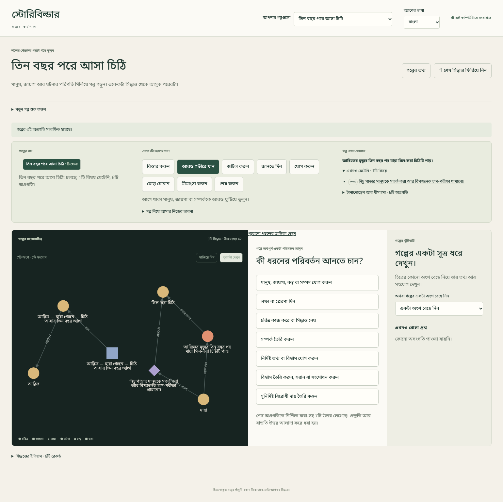

# {{ page.title }}

**ভাষা:** [English](../../topics/richer-story.html) · বাংলা

**এখন আছে (Available) — ৮ নভেম্বর ২০২৬ তারিখে মায়ার রহস্যগল্প দিয়ে কাজের পদ্ধতি যাচাই করা হয়েছে।**

গল্প একটু বড় হলে একসঙ্গে কয়েকজনের ইচ্ছা মনে রাখতে হয়। পরের পাঠ *তিন বছর পরে আসা চিঠি*-তে মায়ার সামনে বাস্তব একটা বিপদ, নীলার বাধা দেওয়ার নিজের কারণ, আর ইচ্ছে করে না-মেটানো একটা প্রশ্ন থাকবে। অ্যাপকে কাহিনি বানাতে বলব না; এই বিষয়গুলো আমরা গড়ে তুলব।

## তিন রকম ভাবনা আলাদা রাখুন

| কী বোঝাতে চান | এই পাঠে কোথায় রাখবেন |
| --- | --- |
| গল্পের জগতে সত্যিই যা ঘটেছে বা সত্যি | **গল্পের বাস্তব তথ্য** পরিসরে নির্দিষ্ট তথ্য, বা লেখকের ঠিক করা ঘটনা |
| কোনো চরিত্রের সন্দেহ | **চরিত্রের বিশ্বাস** পরিসরে বক্তব্য, সঙ্গে কার বিশ্বাস; সেটি ভুলও হতে পারে |
| এখনও বেছে নেননি এমন বিকল্প | **লেখকের নোট**, বা নিশ্চিত করার আগে বদলানো/বাতিল করা খসড়া |
| সমাপ্তিতে যে প্রশ্ন খোলা রাখবেন | স্পষ্ট করে রাখা না-মেটা লক্ষ্য; শুধু নোট লিখলে সেটি না-মেটা বিষয়ের তালিকায় আসে না |

যে ক্রমে গাঁথুনি তৈরি করছি, সেটা আমাদের কাজের ক্রম। দৃশ্যের তালিকা, পাঠক কখন কী জানবেন, বা নিজে থেকে বানানো গদ্যের রূপরেখা নয়। **পাঠক যা জানে** পরিসরেও আলাদা বক্তব্য রাখা হয়; সেটা প্রকাশের সময় সাজানোর পূর্ণ ব্যবস্থা নয়।

## বারবার কাজে লাগবে যে পদ্ধতি

1. **বিস্তার করুন**, **জানতে দিন**, **জটিল করুন**, **যোগ করুন**, **মোড় ঘোরান** বা **মীমাংসা করুন**-এর মতো একটি দিক নিন। তাতে কাজের পছন্দ আসে; আপনার লেখায় কতটা নাটক হলো, অ্যাপ তা বিচার করে না।
2. বলা কাজটির বোতাম নিন। সামনে থাকা প্রশ্নের উত্তর দিয়ে **চালিয়ে যান** নিন। **প্রস্তাবিত অর্থ** না আসা পর্যন্ত দরকারি প্রশ্নের উত্তর দিন; বোতামটি চাপলেই সরাসরি প্রস্তাব আসবে, এমন নয়।
3. তালিকার কোনো ঘর সরাসরি জানতে না চাইলে **বাড়তি তথ্য দিন বা পছন্দ বদলান** খুলুন। সেই প্রশ্নের আগে **চাইলে বলুন:** থাকলে তা নিন; আগে থেকে উত্তর থাকলে **বদলান:** নিন। লিখে বা বেছে **চালিয়ে যান** চাপুন। বাকি ঘরেও একইভাবে দিন। ঠিকভাবে আগেই বেছে দেওয়া থাকলে আবার উত্তর দিতে হবে না।
4. আগে থাকা একজনকে বা একটি বিষয়কে তার নাম দিয়ে নিন। একাধিক মানুষ বা সম্পর্কিত বিষয় চাইলে তালিকার সব নির্দিষ্ট বিষয় বাছুন; আলাদা নাম নিতে macOS-এ Cmd, Windows/Linux-এ Ctrl ধরে নিতে পারেন। বক্তব্যের মান হিসেবে কোনো মানুষকে দিতে চাইলে **তার বদলে আগে থাকা বিষয় বেছে নিন** নিয়ে তাকে বাছুন। আগে থেকেই সেই তালিকা থাকলে সরাসরি বাছুন। সাধারণ লেখা চাইলে **তার বদলে সরাসরি মান লিখুন** নিন।
5. কর্তা, কারণ আর লক্ষ্যসহ পুরো প্রস্তাব পড়ুন। আগে বেছে দেওয়া মানও যাচাইয়ের প্রস্তাব; কথায় অন্য কারও নাম থাকলে ভুল কর্তাও আসতে পারে। **এই অগ্রগতি নিশ্চিত করুন** নেওয়ার আগে তা বদলান। কারও নাম লেখায় থাকলেই ঠিক সম্পর্কটি চিত্রে তৈরি হবে না।
6. আপনার সিদ্ধান্তের সঙ্গে অর্থ মিললেই নিশ্চিত করুন। তখন চিত্র বদলায়। ভাবনা বাদ দিতে **এই খসড়া বাতিল করুন** নিন। প্রস্তাব বদলাতে নিশ্চিত করার আগেই উত্তর বদলান; পরে সাধারণ সম্পাদকের মতো সব বদলাতে পারবেন ধরে নেবেন না।

পরের পাঠে দরকারি প্রতিটি মান দেওয়া আছে। আগের ধাপের উল্লেখ মানে সেই বিষয়টি বেছে নেওয়া; একই নামে নতুন করে বানানো নয়। তথ্য, বক্তব্য আর বিশ্বাসের নাম কাছাকাছি হলে তালিকায় তাদের ধরন দেখুন। বিশ্বাসের তথ্য দেখতে **সত্যতা** আর **চলছে**-এর মান পড়ুন; `false` থাকা আর বিশ্বাসের রেকর্ড না থাকা এক কথা নয়।

## একটা ভাবনা প্রকাশে কত কাজ হচ্ছে দেখুন

যাচাই করা পাঠে ১৯টি অর্থপূর্ণ অগ্রগতি আর আলাদা সমাপ্তির অনুমোদন আছে। ওই ১৯টির জন্য অ্যাপ ইংরেজিতে **১৫৮টি**, বাংলায় **১৫৬টি লেখকের সাড়া** গুনেছে; দুটোতেই প্রতি অগ্রগতিতে মধ্যম সংখ্যা **৭**। এর মধ্যে দিক ও কাজের পছন্দ, উত্তর, বাড়তি ঘর বাছা, সংশোধন আর নিশ্চিত করা আছে। এটা শুধু প্রশ্নের সংখ্যা বা লেখার সময়ের হিসাব নয়।

আগে প্রস্তাব বদলে দেখার অংশটিতে ইচ্ছে করেই একটু বাড়তি কাজ আছে। “পরিচয়ের সংকেত মুছে কপি দেওয়া” সিদ্ধান্তে বাদ দেওয়া খসড়াসহ ১৩টি সাড়া আর নথিভুক্ত ২০টি নিয়ন্ত্রণের কাজ লেগেছে। শেষ মীমাংসায় ইংরেজিতে ১১টি, বাংলায় ৯টি সাড়া: ইংরেজি বাক্য থেকে প্রথমে ভুল কর্তা এসেছিল, নিশ্চিত করার আগেই তা ঠিক করা হয়েছে। অর্থ ঠিক থাকল, কিন্তু বাড়তি কাজের মূল্য দেখা গেল।

নথিভুক্ত কাজের হিসাবে একবার লেখা দেওয়া বা একসঙ্গে কয়েকটি নাম বাছা এক কাজ; প্রতিটি অক্ষর বা মাউসের চাপ গোনা হয়নি। সিদ্ধান্ত ফিরিয়ে আবার করা, বাতিল করা কারণের চক্র, গল্পের তথ্য দেওয়া আর চিত্র দেখা মূল হিসাবের বাইরে আলাদা রাখা হয়েছে। একই লেখকের ঠিক করা গল্পের দুটো স্বয়ংক্রিয় মহড়া এটি; নতুন লেখকদের নিয়ে ব্যবহার-গবেষণা নয়।

## গাঁথুনি বড় হলে কী হয় দেখুন

প্রথম ছয় অগ্রগতির পরে চিত্রে ৭টি বিষয়; দ্বন্দ্বের পরে ১৭টি; অনুমোদিত সমাপ্তিতে **২৪টি বিষয় আর ৪৯টি সংযোগ**। কিছু বিষয় তথ্য আর বিশ্বাস বদলের রেকর্ড; প্রতিটি আলাদা কাহিনির ঘটনা নয়। বিষয় গুনেই গল্প সমৃদ্ধ হলো ধরে নেবেন না।

শেষে পুরো চিত্র একসঙ্গে ধরলে বড় নামগুলো আর আরামে পড়া যায় না। **পুরোটা দেখুন** অবস্থান বোঝাতে কাজে লাগে; বিস্তারিত পড়তে পাশের তথ্য আর সংযোগের বোতাম ভালো। **সাজিয়ে নিন**-এ বিষয়গুলোর জায়গা বদলাতে পারে; পর্দার অবস্থান গল্পের স্থায়ী ঠিকানা নয়। ছোট এই নমুনায় এটুকু অসুবিধা দেখা গেছে; স্তরভাগই একমাত্র সমাধান, তার প্রমাণ নয়। আগে থেকেই নির্দিষ্ট অংশ নিয়ে কাজের আলাদা সুবিধা আছে; এই পাঠে এক জায়গায় থেকে বর্তমান পুরো চিত্রটি দেখছি।

এবার সরাসরি [অসম্ভব চিঠি](impossible-letter.md)-তে গিয়ে গাঁথুনি তৈরি করুন। মাঝের সময়ের অধ্যায়টি এখনও ভাবনার রূপরেখা; এই পাঠের পূর্বশর্ত বা এখন ব্যবহার করার সময়রেখা নয়।
