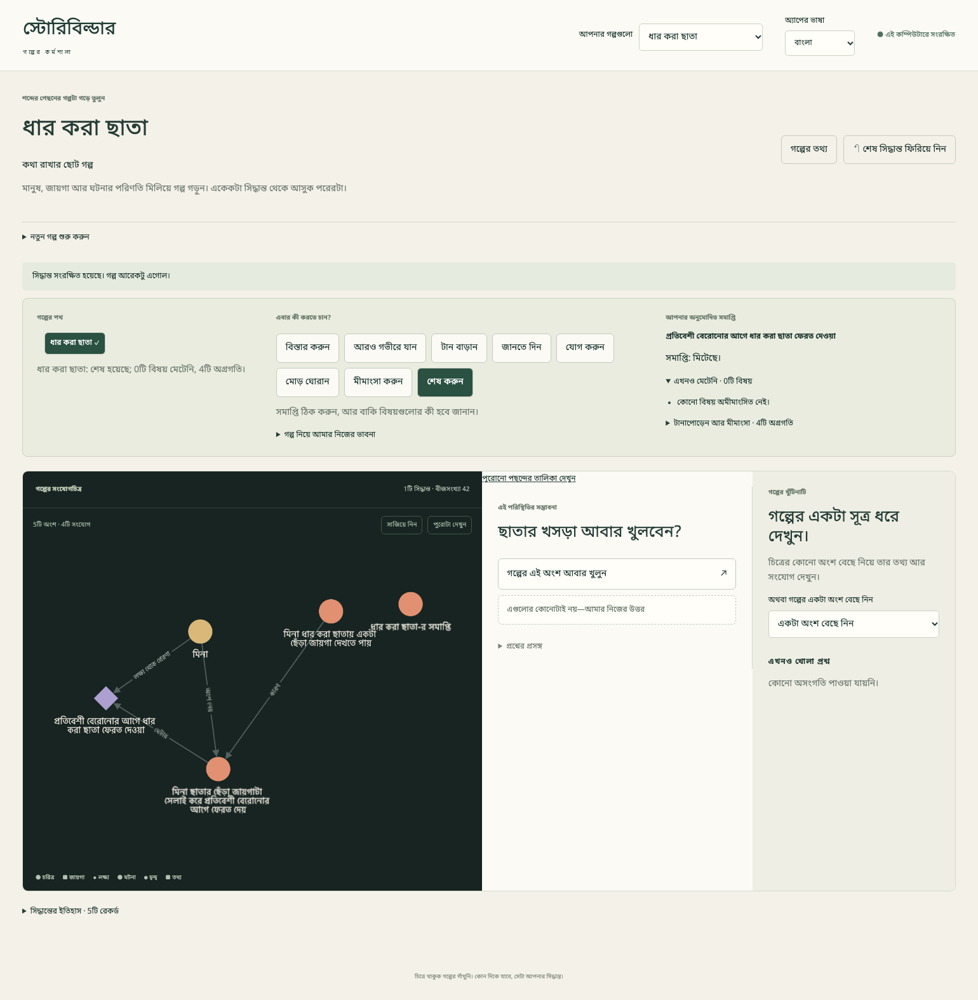

# {{ page.title }}

**ভাষা:** [English](../../topics/workspace.html) · বাংলা

**এখন আছে (Available) — যাচাই করা ব্যক্তিগত কাজের জায়গার পরিচয়।**

লেখার আড়ালে গল্পটা ধরে রাখার জায়গা ভাবুন এটাকে: কে কী চায়, কী ঘটে, আর তার ফলে কী আসে। সংযোগচিত্র তার একটা দৃশ্য; সেটা পুরো গদ্য নয়।

*প্রথম পাঠের পরে আসল কাজের জায়গা। ছোট লেখা দেখতে [ছবিটা বড় করে খুলুন](../assets/04-complete.png)।*

ওপরে **আপনার গল্পগুলো** থেকে সংরক্ষিত কাজ আবার খুলতে পারবেন। **নতুন গল্প শুরু করুন** আরেকটা গল্প তৈরি করে। নতুন গল্প ফাঁকা থাকে, যাতে মানুষ আর পরিস্থিতি আপনার ইচ্ছেমতো যোগ করতে পারেন।

**অ্যাপের ভাষা** থেকে English বা বাংলা বেছে নিলে বোতাম আর নির্দেশ বদলায়; আপনার গল্পের লেখা বদলায় না। গল্পের নামের পাশে **গল্পের তথ্য** খুলে নাম, উপশিরোনাম, সারাংশ, ধরন, গল্পের ভাষা আর লেখকের নোট বদলাতে পারেন। **গল্পের ভাষা** আর **অ্যাপের ভাষা** আলাদা পছন্দ।

**গল্পের পথ** দেখায় আপনি কোন অংশে আছেন। পাশে বেছে নিন এবার কী চান: বিস্তার, গভীরতা, টান বাড়ানো, তথ্য প্রকাশ, সংযোগ, মোড়, মীমাংসা, না সমাপ্তি। নিচের অংশে সেই ভাবনাটা প্রকাশ করার উপায় আসে। প্রস্তাব দেখানোর আগে দরকারি কোনো তথ্য জানতে চাইতে পারে।

প্রস্তাবের জায়গাটা আপনার দেখে নেওয়ার বিরতি। অর্থটা মেলে কি না পড়ুন, দরকারে পছন্দ বদলান, তারপরই নিশ্চিত করুন। নিশ্চিত করার পরে চিত্র বদলায়। **↶ শেষ সিদ্ধান্ত ফিরিয়ে নিন** দিয়ে সবচেয়ে সাম্প্রতিক গ্রহণ করা সিদ্ধান্ত ফেরানো যায়; যেকোনো পুরোনো জায়গা ইচ্ছেমতো সম্পাদনার বোতাম এটি নয়।

বর্তমান অবস্থায় পরিস্থিতি আর এখনও না-মেটা বিষয় দেখা যায়। লক্ষ্য মেটানো আর গল্পের সমাপ্তি অনুমোদন আলাদা সিদ্ধান্ত। চাইলে সমাপ্তি খোলাও রাখতে পারেন; প্রথম পাঠে আমরা মিটে যাওয়া সমাপ্তি নেব।

**পরিকল্পনায় (Envisioned) — বড় কাজের জায়গা।** একই গল্প থেকে সময়রেখা দেখা, গাঁথুনি থেকে গদ্য চাওয়া, গদ্য সম্পাদনা আর নতুন প্রস্তাব পর্যালোচনার জায়গা আমাদের ভাবনায় আছে। যাচাই করা সংস্করণে এগুলো একসঙ্গে থাকা সুবিধা নয়। পরের রূপরেখাগুলো সম্ভাবনার কথা বলে, নেই এমন বোতাম খুঁজতে বলে না।

গল্পের গঠন এই কম্পিউটারে সংরক্ষিত হয়। ব্রাউজার বন্ধ করা আর সংরক্ষিত গল্প মুছে ফেলা এক কথা নয়। এই ব্যবস্থায় এখনও চূড়ান্ত গদ্যপাণ্ডুলিপি সংরক্ষণের আলাদা সুবিধা নেই।
