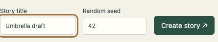
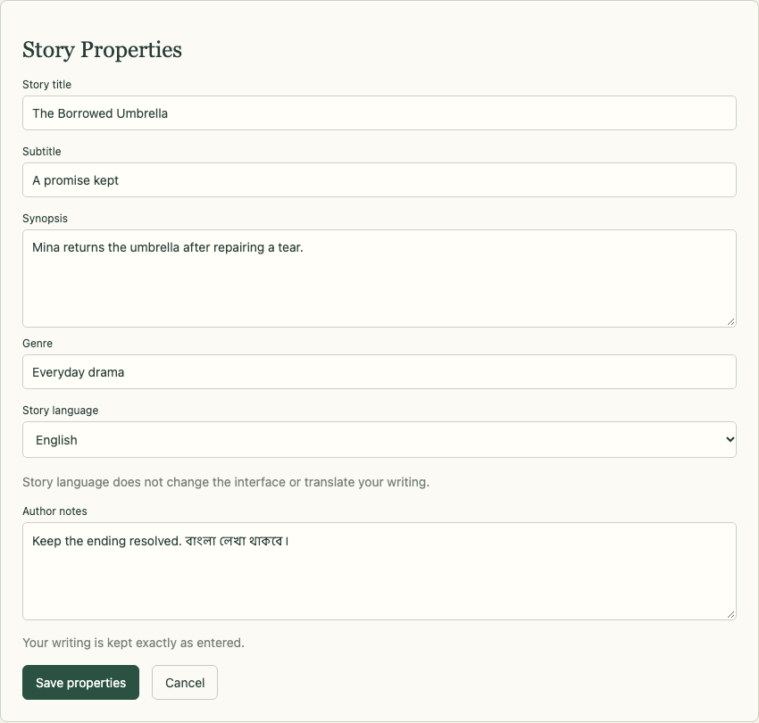
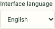
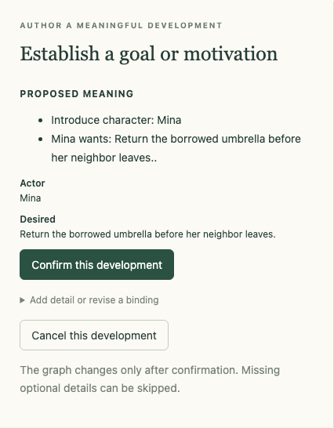
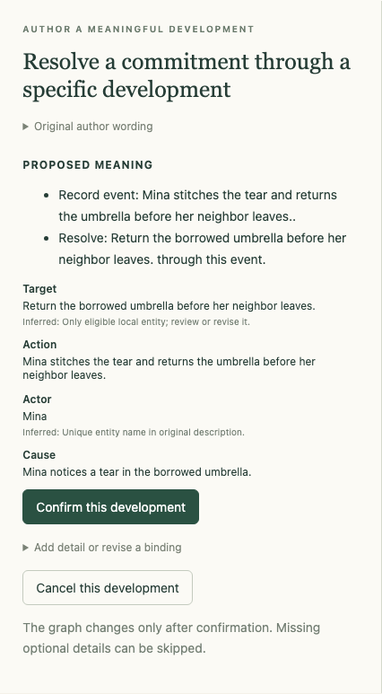
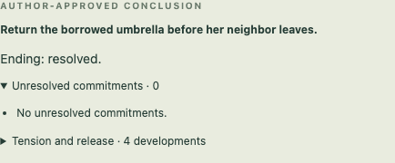

# {{ page.title }}

**Edition:** English · [বাংলা](../bn/topics/first-story.html)

**Available — complete exercise verified in the private application on 8 November 2026.**

You need access to the current private build, open in your browser. This exercise ends with a small **structured story**, not an automatically generated prose manuscript.

## A promise and a tear

Mina has promised to return her neighbor’s borrowed umbrella before the neighbor leaves. On the way, she notices a tear in it. She stitches the tear and returns the umbrella in time. Her promise is kept.

Your aim is to give Mina a goal, introduce that complication, connect the repair to it, and approve the ending. You do not need to supply a whole cast, a detailed setting, or exact dates.

## 1. Give the story a home

Open **Start a new story**. Enter **Umbrella draft** as the **Story title**. Leave **Random seed** at its default and select **Create story ↗**.

*Name the story; the seed does not need a creative decision for this lesson.*

An empty workspace opens. Before adding events, try changing the story’s information.

Choose **Story Properties** beside the story title. Change **Story title** to **The Borrowed Umbrella**. You can also add a subtitle, synopsis, genre, and author notes. In this sample, the subtitle is **A promise kept**. These fields are optional. Choose **English** as **Story language** and select **Save properties**.

*Renaming updates the title and Your stories without making a new story. Optional text, including mixed English/Bangla notes, is stored as written. Reopen Story Properties or reload to check it.*

At the top of the application, **Interface language** changes the controls between **English** and **বাংলা**. Try Bangla, then return to English for the remaining English instructions. This choice is remembered in your browser. It does not change **Story language**, translate your writing, or create another story. Even unsaved property text remains while you switch.

*The interface language is separate from the story’s language. For the full Bangla walkthrough, open the Bangla edition from the chapter’s language link.*

Choose **Expand** among the intention buttons.

## 2. Give Mina something to want

Choose **Establish a goal or motivation** in the development panel.

For **Whose goal is this?**, select **Introduce one instead…**. Enter **Mina** under **What is its name?**, then choose **Continue to preview**.

The next question asks **What do they want to achieve?** Enter:

> Return the borrowed umbrella before her neighbor leaves.

Choose **Continue to preview** again. Despite its name, that button can lead to another essential question before the preview appears.

*Read the proposed meaning before confirming it.*

Check that it introduces Mina and gives her the intended goal. Choose **Confirm this development**. Mina and her goal now appear in the graph, and the status lists an unresolved goal.

## 3. Let something complicate it

Keep **Expand** selected. Choose **Another specific occurrence**. Under **What happened?**, enter:

> Mina notices a tear in the borrowed umbrella.

Choose **Continue to preview**, read the event, and select **Confirm this development**. The graph now includes the discovery. The goal is still unresolved: noticing the tear has not fulfilled the promise.

“Another specific occurrence” is the current event button’s label. You do not need to introduce a second character or a separately named umbrella object for this small lesson.

## 4. Bring the promise to a resolution

Choose **Resolve**, then **Resolve a commitment through a specific development**.

The current sample has one unresolved goal, so the preview can select it. Under **What happens to resolve it?**, enter:

> Mina stitches the tear and returns the umbrella before her neighbor leaves.

Choose **Continue to preview**. Check that the target is Mina’s original goal.

Open **Add detail or revise a binding**, then choose **Optional: Which event enables the resolution?** Select **Mina notices a tear in the borrowed umbrella.** and choose **Continue to preview**. You may collapse the detail menu to read the preview.

*The repair resolves the promise and is connected to the discovery that prompted it. “Cause” here records that narrative connection; it does not supply an exact time.*

Select **Confirm this development**. The unresolved-goal count should now be zero. The app has recorded your intended resolution; it has not assessed the quality of the story’s prose or independently checked a clock deadline.

## 5. Decide that this story is finished

Choose **Conclude**. The panel switches to the existing ending choices. Select **Approve a conclusion with every commitment resolved**.

*Your completion check: **AUTHOR-APPROVED CONCLUSION**, **Ending: resolved**, and **Unresolved commitments · 0**.*

The status now confirms the approved ending without asking you to approve it again.

You did it: Mina has a desire, encounters a complication, acts because of it, and reaches an author-approved ending. The structured story saves locally. Select it again under **Your stories** to resume.

## If something goes wrong

**A preview says the wrong thing:** before confirming, open **Add detail or revise a binding**, choose the relevant **Revise:** question, answer it, and use **Continue to preview** again. Read the corrected preview before confirming. This correction path was tested with the goal wording.

**You approved an ending too soon:** choose **↶ Undo last decision**. It reopens the last approved ending while retaining its history. You can inspect the story and approve the conclusion again. This recovery was also tested. Undo affects the latest accepted decision; it is not a general editor for any earlier decision.

## Make one small change

Optional variation: start a new version in which Mina finds the tear **before** setting out. Change the discovery wording and consider whether the same repair still follows. This variation is a creative invitation, not another verified step-by-step tutorial. You decide what changes the story’s meaning.
