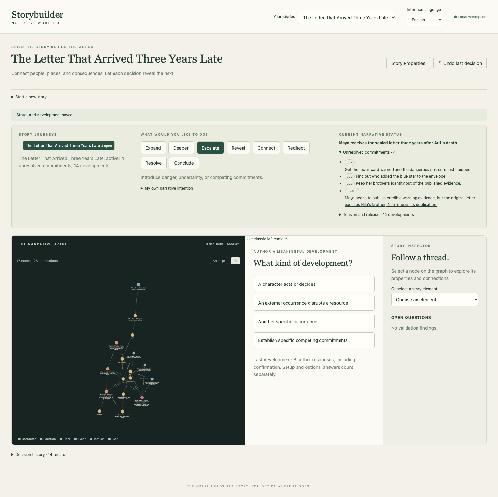
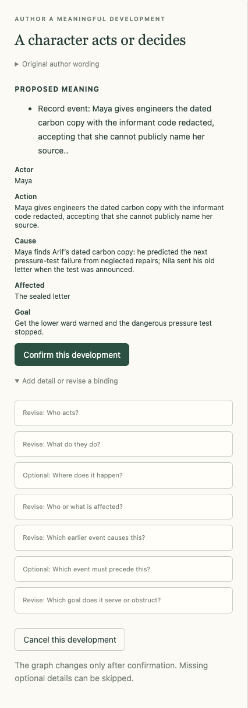
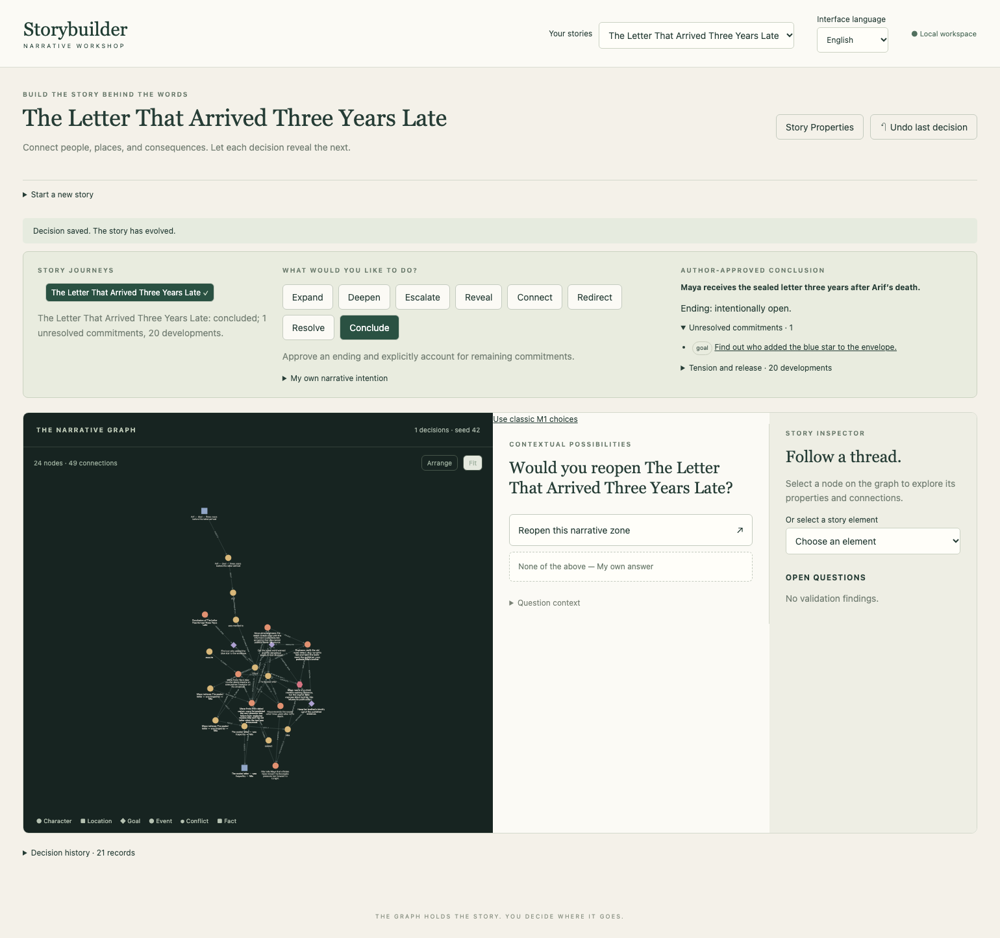
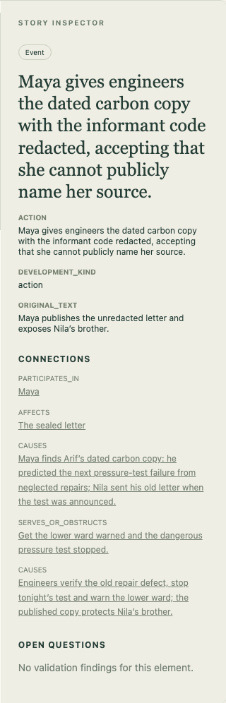

# {{ page.title }}

**Edition:** English · [বাংলা](../bn/topics/impossible-letter.html)

**Available — complete construction exercise verified in the private application on 8 November 2026.**

## The Letter That Arrived Three Years Late

Three years after Arif’s death, his wife Maya receives a sealed letter in handwriting resembling his. It warns that the lower ward will flood at the next floodgate pressure test. Courier Nila knows more than she admits. Her brother supplied confidential maintenance records, and publishing the original letter could identify him.

This is an author’s workshop, with spoilers. We will choose a grounded explanation, not ask Studio to solve the mystery. Nila sent an old, genuine warning when a new test was announced. Maya must find evidence she can use without exposing the informant. An unexplained blue star on the envelope will remain open.

Complete [the tiny story](first-story.md) first, then read [the larger-story working method](richer-story.md). The result here is a structured narrative network, not prose, a sequence of scenes, or a reader-facing revelation schedule. Everything below is built with current controls; no hierarchical regrouping is required.

## Before the first development

Start a new story named **The Letter That Arrived Three Years Late**. If necessary, choose **English** from **অ্যাপের ভাষা** / **Interface language**. In **Story Properties**, keep **Story language → English**. In **Author notes**, write: “Build a scaffold, not prose. Deliberately leave the blue-star sender unresolved.” Save the properties.

Follow the numbered developments in order. Each begins with the indicated intention and mechanism. Enter all listed fields using the [larger-story working method](richer-story.md); some will already be inferred. References such as “step 5” mean select the existing element, not type those words or create it again. Character, Proposition, Fact and Belief types distinguish similar labels in selectors. Keep the predicate and entity choices identical when a later step refers to the same proposition.

## 1. Establish the impossible arrival

We establish the death as an objective story fact. Resembling Arif’s handwriting is evidence to investigate, not proof that a dead man wrote yesterday. Maya’s goal makes the warning matter to people beyond her grief.

### 1. Introduce Maya

Choose **Expand → Introduce a person, place, object, or resource**.

- **What are you introducing?** — Character
- **What distinguishes it? Give it a name.** — Maya

Review the proposed meaning and bindings, then **Confirm this development**.

### 2. Remember Arif

Choose **Expand → Introduce a person, place, object, or resource**.

- **What are you introducing?** — Character
- **What distinguishes it? Give it a name.** — Arif
- **What context should be retained?** — Maya’s husband; he died three years before the letter arrived.

Review the proposed meaning and bindings, then **Confirm this development**.

### 3. Keep the warning concrete

Choose **Expand → Introduce a person, place, object, or resource**.

- **What are you introducing?** — Object
- **What distinguishes it? Give it a name.** — The sealed letter
- **What context should be retained?** — Handwriting resembling Arif’s warns: at the next floodgate pressure test, the lower ward will flood.

Review the proposed meaning and bindings, then **Confirm this development**.

### 4. Establish the death as fact

Choose **Reveal → Establish a concrete fact or belief**.

- **Who or what is the proposition about?** — Arif (step 2)
- **What is asserted about it?** — died
- **What is the value or related entity?** — three years before the letter arrived
- **Who can treat this as known?** — objective

Review the proposed meaning and bindings, then **Confirm this development**.

### 5. The letter arrives

Choose **Expand → Another specific occurrence**.

- **What happened?** — Maya receives the sealed letter three years after Arif’s death.
- **Who or what initiated it?** — Maya (step 1)
- **Who or what is affected?** — The sealed letter (step 3)

Review the proposed meaning and bindings, then **Confirm this development**.

### 6. Give Maya a goal beyond grief

Choose **Deepen → Establish a goal or motivation**.

- **Whose goal is this?** — Maya (step 1)
- **What do they want to achieve?** — Get the lower ward warned and the dangerous pressure test stopped.
- **Who or what does the goal concern?** — The sealed letter (step 3)

Review the proposed meaning and bindings, then **Confirm this development**.

**Check:** seven graph nodes and one unresolved goal.

## 2. Let suspicion acquire a cost

The courier stamp points toward Nila but does not prove forgery. We deliberately give Maya a mistaken belief. Nila’s wish to protect her brother is a competing motivation, not evidence that she is a villain. The blue-star question becomes an explicit goal so that the ending can acknowledge it.

### 7. Find a misleading stamp

Choose **Reveal → Another specific occurrence**.

- **What happened?** — Maya finds Nila’s new courier stamp beside an unexplained blue star on the envelope.
- **Who or what initiated it?** — Maya (step 1)
- **Who or what is affected?** — The sealed letter (step 3)
- **Which earlier event causes this?** — Maya receives the sealed letter three years after Arif’s death. (step 5)

Review the proposed meaning and bindings, then **Confirm this development**.

### 8. Name the question we will leave open

Choose **Deepen → Establish a goal or motivation**.

- **Whose goal is this?** — Maya (step 1)
- **What do they want to achieve?** — Find out who added the blue star to the envelope.
- **Who or what does the goal concern?** — The sealed letter (step 3)

Review the proposed meaning and bindings, then **Confirm this development**.

### 9. Introduce Nila

Choose **Expand → Introduce a person, place, object, or resource**.

- **What are you introducing?** — Character
- **What distinguishes it? Give it a name.** — Nila
- **What context should be retained?** — A courier who once worked with Arif; her brother supplied confidential maintenance records.

Review the proposed meaning and bindings, then **Confirm this development**.

### 10. Connect Maya and Arif

Choose **Connect → Establish a relationship**.

- **Who is the relationship from?** — Maya (step 1)
- **How do they relate?** — was married to
- **Who is the relationship to?** — Arif (step 2)

Review the proposed meaning and bindings, then **Confirm this development**.

### 11. Give Nila a competing goal

Choose **Deepen → Establish a goal or motivation**.

- **Whose goal is this?** — Nila (step 9)
- **What do they want to achieve?** — Keep her brother’s identity out of the published evidence.
- **Who or what does the goal concern?** — The sealed letter (step 3)

Review the proposed meaning and bindings, then **Confirm this development**.

### 12. Let Maya suspect forgery

Choose **Reveal → Establish a concrete fact or belief**.

- **Who or what is the proposition about?** — The sealed letter (step 3)
- **What is asserted about it?** — was forged by
- **What is the value or related entity?** — Choose an existing entity: Nila (step 9)
- **Who can treat this as known?** — belief
- **Who holds the belief?** — Maya (step 1)
- **Which event establishes or reveals it?** — Maya finds Nila’s new courier stamp beside an unexplained blue star on the envelope. (step 7)

Review the proposed meaning and bindings, then **Confirm this development**.

This creates a proposition, Maya’s active belief, and its acquisition at the stamp discovery. It does **not** establish objective forgery.

## 3. Make the conflict specific

An earlier test creates urgency, but urgency alone is not a structured conflict. Bind the two people and their goals to the disagreement about publishing the letter. The warning and confidentiality can both matter; decide whether this tension is convincing in your own version.

### 13. Bring the test forward

Choose **Escalate → A character acts or decides**.

- **Who acts?** — Nila (step 9)
- **What do they do?** — Nila tells Maya that officials have moved the floodgate pressure test forward to tonight.
- **Which event must precede this?** — Maya receives the sealed letter three years after Arif’s death. (step 5)

Review the proposed meaning and bindings, then **Confirm this development**.

### 14. Bind the conflict to people and goals

Choose **Escalate → Establish specific competing commitments**.

- **What makes the commitments incompatible?** — Maya needs to publish credible warning evidence, but the original letter exposes Nila’s brother; Nila refuses its publication.
- **Who is involved?** — Maya (step 1); Nila (step 9)
- **What is contested?** — The sealed letter (step 3)
- **Which goals compete?** — Get the lower ward warned and the dangerous pressure test stopped. (step 6); Keep her brother’s identity out of the published evidence. (step 11)

Review the proposed meaning and bindings, then **Confirm this development**.

**Check:** the conflict has both participants and both goals; the blue-star goal remains separate. The moved deadline is authored context, not an automatic calendar calculation.

## 4. Choose what evidence to trust and share

The carbon copy supplies a grounded explanation: Arif warned about the next test, not a date known from beyond the grave. Nila delayed sending his real letter until a test was announced. Record the objective denial of forgery separately from Maya’s belief correction. The software will not silently change her mind for you.

### 15. Find a dated carbon copy

Choose **Expand → A character acts or decides**.

- **Who acts?** — Maya (step 1)
- **What do they do?** — Maya finds Arif’s dated carbon copy: he predicted the next pressure-test failure from neglected repairs; Nila sent his old letter when the test was announced.
- **Which earlier event causes this?** — Nila tells Maya that officials have moved the floodgate pressure test forward to tonight. (step 13)
- **Who or what is affected?** — The sealed letter (step 3)
- **Which goal does it serve or obstruct?** — Get the lower ward warned and the dangerous pressure test stopped. (step 6)

Review the proposed meaning and bindings, then **Confirm this development**.

### 16. Record evidence against forgery

Choose **Reveal → Establish a concrete fact or belief**.

- **Who or what is the proposition about?** — The sealed letter (step 3)
- **What is asserted about it?** — was forged by
- **What is the value or related entity?** — Choose an existing entity: Nila (step 9)
- **Who can treat this as known?** — objective
- **Is this proposition affirmed or denied?** — denied
- **Which event establishes or reveals it?** — Maya finds Arif’s dated carbon copy: he predicted the next pressure-test failure from neglected repairs; Nila sent his old letter when the test was announced. (step 15)

Review the proposed meaning and bindings, then **Confirm this development**.

Reuse the same letter, predicate and Nila entity from step 12. **denied** negates forgery; it does not deny Arif’s death. The prior belief remains active until the next step.

### 17. Let Maya change her mind

Choose **Reveal → Acquire, withdraw, or correct a belief**.

- **How does the belief change?** — correct
- **Whose belief changes?** — Maya (step 1)
- **At which story event does it change?** — Maya finds Arif’s dated carbon copy: he predicted the next pressure-test failure from neglected repairs; Nila sent his old letter when the test was announced. (step 15)
- **Which proposition is acquired or replaces the old belief?** — Proposition (step 12)
- **Which existing belief is withdrawn or corrected?** — Belief (step 12)
- **Is the new belief affirmed or denied?** — denied

Review the proposed meaning and bindings, then **Confirm this development**.

The previous belief becomes inactive; its record survives. The new belief denies the same forgery proposition. Its label alone can look similar: inspect **truth** and **active** as well.

### 18. Share evidence at a cost

Choose **Redirect → A character acts or decides**.

For a safe revision exercise, first enter the following draft under **What do they do?**, continue to the preview, then revise that binding before confirming:

> Maya publishes the unredacted letter and exposes Nila’s brother.

Replace it with the final action below. The first version is an alternative you reject, not an event that happens in this story.

- **Who acts?** — Maya (step 1)
- **What do they do?** — Maya gives engineers the dated carbon copy with the informant code redacted, accepting that she cannot publicly name her source.
- **Which earlier event causes this?** — Maya finds Arif’s dated carbon copy: he predicted the next pressure-test failure from neglected repairs; Nila sent his old letter when the test was announced. (step 15)
- **Who or what is affected?** — The sealed letter (step 3)
- **Which goal does it serve or obstruct?** — Get the lower ward warned and the dangerous pressure test stopped. (step 6)

Review the proposed meaning and bindings, then **Confirm this development**.

## 5. Resolve the danger; keep one question open

The engineers stop the test because Maya shares usable evidence. We explicitly mark the safety goal, the confidentiality goal and their conflict resolved together. This records our chosen outcome; Studio does not inspect engineering evidence or judge whether the compromise is persuasive. The blue star remains unexplained by choice.

### 19. Stop the test and protect the source

Choose **Resolve → Resolve a commitment through a specific development**.

- **What commitment is resolved?** — Get the lower ward warned and the dangerous pressure test stopped. (step 6)
- **What happens to resolve it?** — Engineers verify the old repair defect, stop tonight’s test and warn the lower ward; the published copy protects Nila’s brother.
- **Who brings this about?** — Maya (step 1)
- **Which event enables the resolution?** — Maya gives engineers the dated carbon copy with the informant code redacted, accepting that she cannot publicly name her source. (step 18)
- **Which related commitments are resolved by the same development?** — Keep her brother’s identity out of the published evidence. (step 11); Maya needs to publish credible warning evidence, but the original letter exposes Nila’s brother; Nila refuses its publication. (step 14)

Review the proposed meaning and bindings, then **Confirm this development**.

## Approve an ending with one deliberate loose end

There should now be one unresolved commitment: **Find out who added the blue star to the envelope.** The other goals and their conflict are resolved. Choose **Conclude**, then **Approve an intentionally ambiguous ending; leave listed commitments open**. The closed-ending choice is unavailable while that goal remains.

Check **AUTHOR-APPROVED CONCLUSION**, **Ending: intentionally open**, and one unresolved commitment. This ending closes the danger plot and accepts the unanswered sender question. It does not create a portable cross-story hook or a finished prose ending.

## Recover a decision without rewriting history

Before approving the ending, you can test **↶ Undo last decision** immediately after step 19. It removes that resolution and restores four commitments: the safety goal, privacy goal, conflict and blue-star goal. The undone record remains. Repeat step 19, using its original bindings, then approve the intentionally open ending. This exact recovery was tested. There is no redo button or unrestricted earlier-node editor; do not treat Undo as one.

## Follow a distant connection

After approval, use **Or select a story element** to select Maya’s redaction decision from step 18. In the inspector, follow the connection to the carbon-copy discovery from step 15; the **CAUSES** connection leads back to the discovery that made the decision possible. The inspector lists relation names and neighbors without labeling incoming/outgoing direction; use the graph arrows or the explicit bindings from steps 15 and 18 to verify direction. The stamp discovery and arrival are other branches; not every earlier event caused every later one.

The inspector also retains **original_text**, including the rejected first draft from step 18. That is provenance, not another event. The confirmed label and **action** contain the redacted-copy decision.

The element picker disappears once an element is selected. You can follow connection buttons or click graph nodes; reload to reset selection and bring back the picker. **Fit** shows the whole network; zoom in or use the inspector for full wording. **Arrange** changes the layout, not the story. Returning to a saved story preserves the graph and approved ending.

## Try an author’s alternative

What if Maya refused to protect the informant? What if Nila sent a copy instead of the original? These are possible new versions, not facts in this verified version. Try a separate story so you do not need to rewrite older accepted decisions. If you make the blue-star sender known, resolve that goal explicitly before asking for a fully closed ending. You decide whether the explanation is satisfying; Studio records the commitments you approve.
