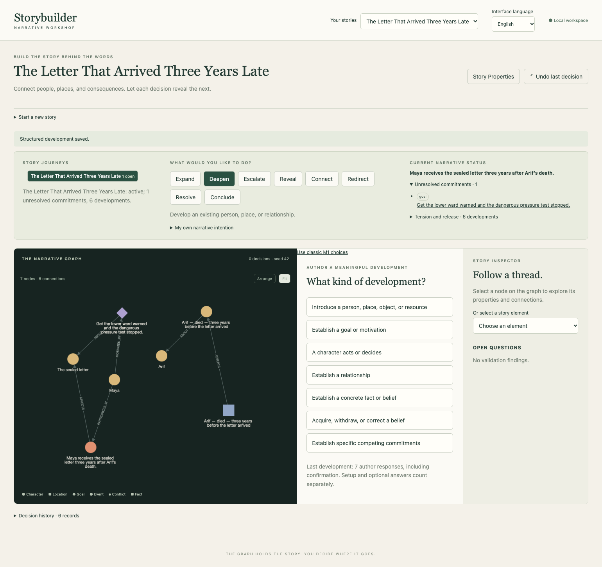

# {{ page.title }}

**Edition:** English · [বাংলা](../bn/topics/richer-story.html)

**Available — working method verified with the Maya mystery on 8 November 2026.**

A larger story asks you to hold several intentions at once. Our next exercise, *The Letter That Arrived Three Years Late*, gives Maya a practical danger to investigate, Nila a reason to resist her, and a question we deliberately leave unanswered. We construct these commitments rather than ask the app to invent a plot for us.

## Keep three kinds of notes apart

| What you mean | Where to put it in this exercise |
| --- | --- |
| Something established in the story world | A concrete fact with **objective** scope, or an explicitly authored event |
| Something a character suspects | A proposition with **belief** scope and its holder; it may be false |
| An alternative you have not chosen | **Author notes**, or a draft you revise/cancel before confirmation |
| A question the ending should acknowledge | An explicit goal left unresolved; a note alone is not a listed commitment |

The story’s construction order is our working order. It is not a scene list, reader chronology or automatic prose outline. Even **reader** scope records a distinct assertion; it is not a complete revelation scheduler.

## The repeatable control pattern

1. Choose an intention, such as **Expand**, **Reveal**, **Escalate**, **Connect**, **Redirect**, or **Resolve**. These select available mechanisms; they do not evaluate the dramatic effect of your writing.
2. Choose the specified mechanism. Answer the immediate question and select **Continue to preview**. Repeat until **Proposed meaning** appears; that button can lead to another question first.
3. For a listed field not asked directly, open **Add detail or revise a binding**. Choose **Optional:** followed by its prompt, or **Revise:** if it already has an inferred/supplied answer. Enter or select its value, then **Continue to preview**. Repeat for the remaining fields. Fields inferred correctly need no resubmission.
4. For a single existing entity, select its displayed name. For several participants or related commitments, select all named entries in the multi-select (use Cmd on macOS or Ctrl on Windows/Linux for separate entries). For a proposition whose value is a person, choose **Choose an existing entity instead** and select that person. If already in entity mode, select directly. Use **Use a literal value instead** for plain text.
5. Read the whole preview, including actor, cause and goal bindings. Inferences are proposals; an incidental character name can bind the wrong actor. Revise it before **Confirm this development**. Text naming someone does not guarantee the intended structural relationship.
6. Confirm only when meaning matches your decision. The graph changes at confirmation. To abandon an idea, use **Cancel this development**. To change a preview, revise it; do not confirm and hope to edit it later.

The detailed exercise gives every value needed. A reference to an earlier step means select that existing element, preserving identity. Selectors may show a type beside a label; this matters when Fact, Proposition and Belief labels look alike. The inspector shows **truth** and **active** for belief records; `false` is not the same as a missing belief.

## Watch the cost of expressing an idea

The verified workshop contains 19 semantic developments plus a separate ending approval. For those 19, the app recorded **158 author responses in English and 156 in Bangla**, with a median of **7 per development** in either language. Those counters include intention/mechanism choices, supplied answers, optional-field selection, corrections and confirmation. They are not a count of questions alone or an estimate of writing time.

The preview revision exercise deliberately adds work. The meaningful decision “share a redacted copy” took 13 recorded responses and 20 instrumented control actions, including the rejected draft. The final resolution needed 11 recorded responses in English and 9 in Bangla; the English wording initially inferred the wrong actor, which was corrected before confirmation. Semantic accuracy was preserved, at a visible interaction cost.

Instrumented control actions count one text entry or multi-select operation as one action, not each keystroke or physical click. Recovery, the rejected cycle experiment, metadata setup and inspection are reported separately from the main construction. These are two automated rehearsals of one authored story, not a study of novice writers.

## Watch the network grow

After the first six developments there are 7 nodes; after the conflict there are 17; the approved ending has **24 nodes and 49 connections**. Some are support records for facts and belief changes, not additional plot beats. Do not equate node count with story richness.

In the final whole-network view, long labels become too small to read comfortably. Fit remains useful for orientation; the inspector and explicit connections are useful for reading. Arrange can move elements between layouts, so screen position is not a durable story reference. This is observed friction in a modest sample, not proof that hierarchy is the only solution. Existing focused subjourneys are a separate capability; this exercise stays in one workspace to observe the current flat network.

Continue directly to [The Impossible Letter](impossible-letter.md) for the complete construction. The intervening time chapter remains a conceptual outline; it is not a prerequisite or an available timeline control.
