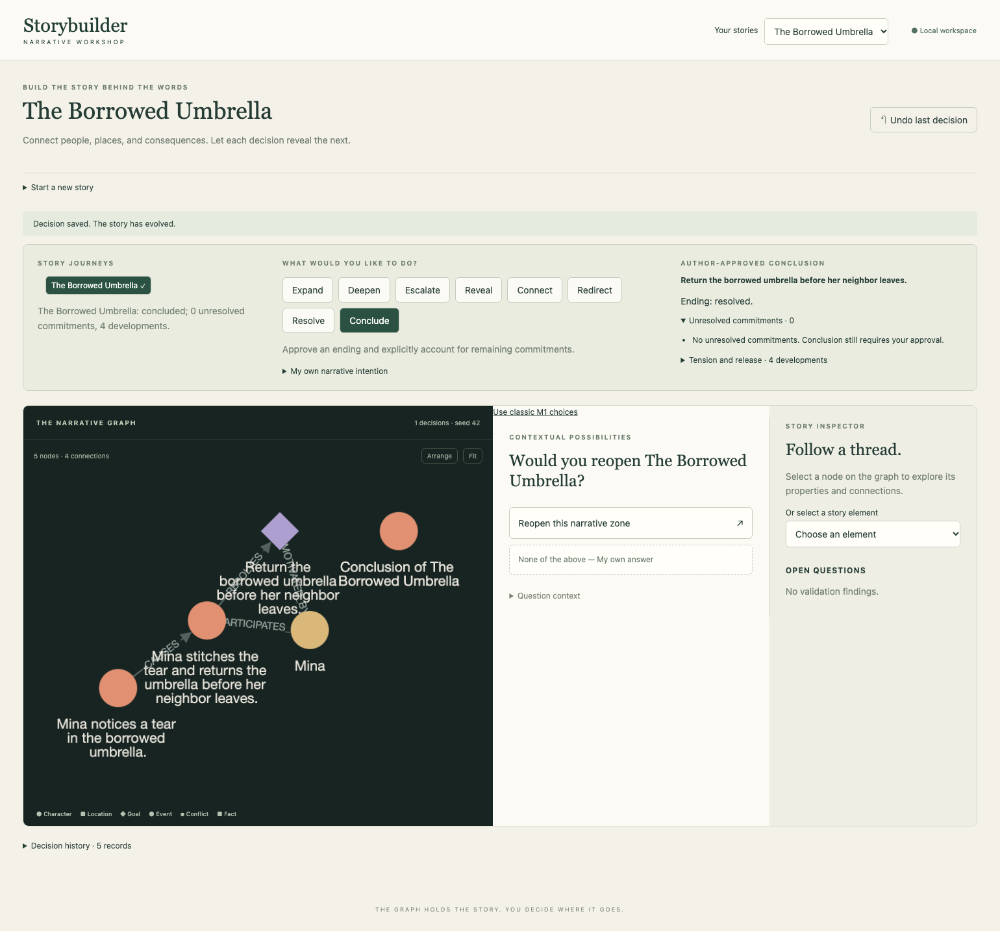

# {{ page.title }}

**Available — orientation to the verified private workspace.**

Think of the workspace as a place to keep the story behind the words: who wants something, what happens, and what follows. The graph is one way to see those connections; it is not the finished prose.

*The real private workspace after the first exercise. [Open the full-size image](../assets/04-complete.png) to inspect small labels.*

At the top, **Your stories** lets you return to saved work. **Start a new story** creates another project. A new story begins empty, so you can introduce the people and circumstances you actually want.

**Story journeys** keeps your place. Beside it, the intention buttons ask what you want to do next: expand, deepen, escalate, reveal, connect, redirect, resolve, or conclude. Below them, the development panel offers ways to express that intention. The panel can ask for a missing essential detail before showing a preview.

The preview is a pause for your judgment. Read the proposed meaning, correct a binding if needed, and confirm only when it expresses your intention. The graph changes after confirmation. **Undo last decision** can recover the most recent accepted decision; it is not an unrestricted edit of any earlier moment.

The status area shows the current situation and unresolved commitments. Resolving a goal and approving an ending are separate author choices. You may also deliberately approve an open ending; this first exercise uses a resolved one.

**Envisioned — the broader workspace.** A derived timeline, an integrated scaffold-to-prose action, a prose editor, and a review space for generated inventions belong to the intended experience. They are not present as integrated controls in this verified build. The later outlines describe them as possibilities, not instructions to find nonexistent buttons.

Local saving is available for the structured story. Closing a browser is different from deleting its saved project. The current application does not save a final prose manuscript as part of that workflow.
